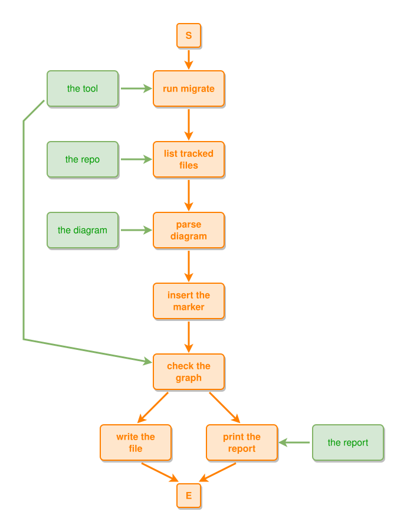

# ipmt-migrate

`gl:cmd-dev/ipmt-migrate` adds an explicit `::t` to every unmarked thing in ipmt
text and changes nothing else. It is step one of making event the default node kind
(the parser default is event since 0.6.0): once every thing carries `::t`, the parser default can flip without any
diagram changing meaning.

## Coming from 0.4.x

Up to 0.4.x an unmarked node was a thing. From 0.6.0 it is an event, and the tools read
old text without a warning: each unmarked thing becomes an event and its arrows change
relation. Migrate once, before the first run of the new tools, in each git repository
that holds ipmt text:

```bash
go run github.com/infinite-pm/ipm-tools/cmd-dev/ipmt-migrate@v0.6.0 -root . -write
```

The result means the same under 0.4.x and under 0.6.0. Run it only while the text is
still written for the old default: on text that already leaves events unmarked it would
mark those events as things. A second run on migrated text that still writes `::e` on
its events changes nothing.

## Usage

```bash
go run ./cmd-dev/ipmt-migrate -root path/to/repo            # dry run (the default)
go run ./cmd-dev/ipmt-migrate -root path/to/repo -write     # write the files
go run ./cmd-dev/ipmt-migrate -prose -root path/to/repo     # read-only prose report
go run ./cmd-dev/ipmt-migrate -write a.md b.ipmt             # explicit files
```

- `-root DIR` takes the files from `git ls-files -z` of that repo: tracked files only,
  so untracked and ignored files (such as `temp/`) are skipped. `DIR` that is not a git
  repository, no input at all, or an unreadable file is an error with exit status 2.
  Tracked symlinks are skipped (the target is listed on its own), so no file is processed twice.
- Files are `*.ipmt` (the whole file is one diagram) and `*.md` (every ` ```ipmt ` fence,
  found with `markdown.ScanIPMTBlocks`: wrapper fences such as a ` ````md ` example are
  literal text and are left alone). A file keeps its own line endings, CRLF included.
- The tool never changes prose, comments, tooltips, edge labels or fence lines.

## What gets `::t`

A node spec without a kind marker whose node is a thing in the parsed graph. The spec's
exact span comes from the parser (`parser.Options.SpecHook`), never from a regex, and
`::t` goes right after the name (after the closing quote of a quoted name), before a
tooltip string: `book "tip" ::tip` becomes `book ::t "tip" ::tip`.

Left alone: a spec with a marker (`::t`, `::e`, `::c`), an undecided `::?et` spec, a bare
mention of an event or a concept (the first kind wins), and a bare reference to an alias
defined earlier.

## Known limit: fixtures in code

The migration reads `.ipmt` and `.md` files only. It does NOT rewrite ipmt text inside
Go string literals, testdata of other formats or `.txt` fixtures. After the event-default
change, an unmarked quoted thing there (for example `a --> "the phone"` in a test fixture)
reads as an event, and the test that parses it can go red.

Before a flip, grep the repo's Go tests and fixtures for ipmt text:

```bash
git grep -nE '"[^"]+" *--[a-z0-9:_ -]*>'
```

Mark the things found by hand with `::t`, then run the repo's full tests with the new tools.

## The proof

For every diagram, also in a dry run, the tool parses the original and the migrated text
and requires identical node ids, names, aliases, types, tooltips and edges (source, target,
relation, direction, label) in two ways:

1. the migrated text with the current grammar equals the original;
2. the migrated text with `parser.Options{DefaultNodeType: model.Event}` equals the original
   with the current default. This is the proof for the later default flip.

A diagram that does not parse today (the deliberate error examples) is listed as
"unparsable, left unchanged". A diagram whose proof fails is not written, is listed as
`FAIL`, and makes the exit status 1. A second run changes nothing.

## Report

One line per file with fences: `file: fences=N nodes=N marked=N`, then
`TOTAL (dry-run|write) files= changed= fences= nodes= marked= unparsable= fail=`, then the
`unparsable` and `FAIL` lists as `file:line: cause`.

`-prose` never writes. It lists as `file:line: text` every line outside ipmt fences (and
every comment inside a fence or `.ipmt` file) that contains `::t` or talks about the
default, optional or unmarked things, events or markers, and the fences that already
carry an explicit `::t` (teaching examples). It ends with `PROSE-TOTAL`. That list drives
the documentation rewrite after the flip.

## The manifest

`ipmt-markers.manifest` (repo root) lists every place that deliberately shows explicit
`::e` / `::t` markers, so the flip keeps them and a test notices when one is lost. It is
TAB-separated; `#` lines and blank lines are ignored; paths are relative to the repo root;
line numbers are never stored.

```text
rule<TAB>thing                                         the repo's default node kind (event after the flip)
file<TAB>PATH<TAB>e=N t=N<TAB>why                      the whole file shows explicit markers; N = occurrences at manifest time
fence<TAB>PATH<TAB>ANCHOR<TAB>e=N t=N<TAB>why          one ipmt fence; ANCHOR = one exact line of it (must match exactly one fence)
line<TAB>PATH<TAB>EXACT LINE TEXT<TAB>why              a prose line about the markers; it must contain ::e, ::t or ::c
```

`go run ./cmd-dev/ipmt-migrate -check-manifest -root DIR [-manifest FILE]` prints one
`FAIL path: reason` per violated entry and exits 1: a count below the manifest's, an
anchor that matches no fence or more than one, a `line` that is no longer present verbatim,
a missing file, a malformed or missing manifest. Unreadable input exits 2. `TestRepoManifest`
runs the same check on this repository.

`go run ./cmd-dev/ipmt-migrate -manifest-draft -root DIR` drafts a manifest for a repo from
the `-prose` report and prints it to stdout (read-only, it never writes a file; it refuses
`-write`, `-prose`, `-flip` and `-check-manifest`). Each file with a teaching fence becomes
a `file` entry (counts of the whole file); each prose line with `::e`, `::t` or `::c` becomes
a `line` entry; prose lines without a marker and lines holding a TAB are only `# path:line:`
comments. It ends with a `# DRAFT-TOTAL` comment. The lead reviews and prunes the draft
before saving it as `DIR/ipmt-markers.manifest`; the draft parses and passes
`-check-manifest` as printed.

What is in the manifest of ipm-tools: the notation docs (`docs/ipmt-spec.md`,
`docs/how-to-model.md`, ...), `docs/ipmt-ex/`, `docs/solver-examples/`, the parser fixtures
under `tests/ipmt/`, and the prose lines that state the notation. Not in it: the generated
`tests/solver` and `tests/layout-gen` copies and `docs/dev/layout-gen/`; they follow their
sources when the per-repo step runs.

## The flip

```bash
go run ./cmd-dev/ipmt-migrate -flip -root DIR              # dry run, needs DIR/ipmt-markers.manifest
go run ./cmd-dev/ipmt-migrate -flip -root DIR -write       # write the files and set the rule line to event
go run ./cmd-dev/ipmt-migrate -flip -manifest FILE a.md    # explicit files; the manifest only says what to keep
```

Per ipmt fence (or `.ipmt` file) outside the manifest: step A adds `::t` to every unmarked
thing (as above), step B deletes the explicit `::e` of every event spec together with the one
space before it (tooltip, alias and labels stay; positions come from `parser.Options.SpecHook`,
never from a regex; CRLF stays). A fence or file the manifest keeps gets step A only: it keeps
its explicit `::e`, but an unmarked thing in it still gets `::t`, because after the flip an
unmarked name would turn into an event.

The proof, per fence: the original parsed with the old default (thing, kept in the tool on purpose via `Options.DefaultNodeType`) equals the
flipped text parsed with `parser.Options{DefaultNodeType: model.Event}` (same node ids,
names, aliases, types, tooltips, edges). A failed proof is not written, is listed as `FAIL`,
and the exit status is 1. Text that does not parse today is left alone and listed as
unparsable.

### The invalid lane

`-flip` also takes the negative examples: `.ipmt-invalid` files (selected by `-root`) and
`ipmt-invalid` fences in `.md` files. They do not parse into a graph, so there is nothing to
compare with `sameGraph`. The edits are the same as above. The proof is the rejection: the old
text under the thing default and the flipped text under the event default must be rejected
with the same message. The message is the parser error text or, for text that parses and is
rejected by the validator (self-loop), the validator's error findings (code and message);
positions are not compared. Because the parser stops at its first error, only the specs
resolved before it are edited; later text is never read by either default.

- the proof holds: the file or fence is flipped, status ok;
- `FAIL`: the old text is not rejected at all, or the flipped text is accepted, or the
  message changes (both messages are printed). The text stays unchanged and the exit status is
  1. The owner reviews the case and rewrites the fixture by hand, so that the error is the
  intended one;
- unparsable, left unchanged: the parse fails before any node spec is resolved (a syntax error
  on the first line of a fence), so there is nothing to mark. Such a fence has no unmarked
  node the parser read; it is listed, never silent.

`rule event` in the manifest means the repo is flipped: `-flip` prints `already flipped`,
changes nothing and exits 0, so it never adds a `::t` twice. `-flip -write` sets the rule
line to `event` only when no fence failed. Without a manifest (`-manifest FILE`, or
`-root DIR` with `DIR/ipmt-markers.manifest`) `-flip` refuses with exit 2.

### `-invalid-only`

```bash
go run ./cmd-dev/ipmt-migrate -flip -invalid-only -root DIR [-write]
```

For a repo whose valid places were already flipped (manifest `rule event`) while the invalid
lane still has the old meaning. Only `.ipmt-invalid` files and `ipmt-invalid` fences are
processed; `.ipmt` files and `ipmt` fences are left untouched and counted as `skipped` (a file
with both kinds, such as a spec with a valid and an invalid fence, would otherwise get `::t`
on its already flipped valid fences). The manifest rule is neither checked as "already
flipped" (so the run happens with `rule event`) nor rewritten by `-write`. Without `-flip` the
flag is a usage error (exit 2). The report has an extra line `invalid-only: skipped=N ...`.

Report: `file: fences=N things-marked=N events-unmarked=N`, then
`TOTAL (dry-run|write) files= changed= fences= things-marked= events-unmarked= kept= unparsable= fail=`.
`kept` counts the fences the manifest keeps.

## Flow

```ipmt
# the migration of one repo
run migrate
list tracked files
parse diagram
insert the marker
check the graph
write the file
print the report
the tool ::t --> run migrate
the repo ::t --> list tracked files
run migrate --> list tracked files --> parse diagram --> insert the marker --> check the graph --> write the file
check the graph --> print the report
the tool ::t --> check the graph
the diagram ::t --> parse diagram
the report ::t --> print the report
```
<!-- ipm-svg id=100 hash=cffe9a18 -->


Each diagram goes through parse, insert, check; only a diagram whose check passes is
written, and the report lists the rest.
