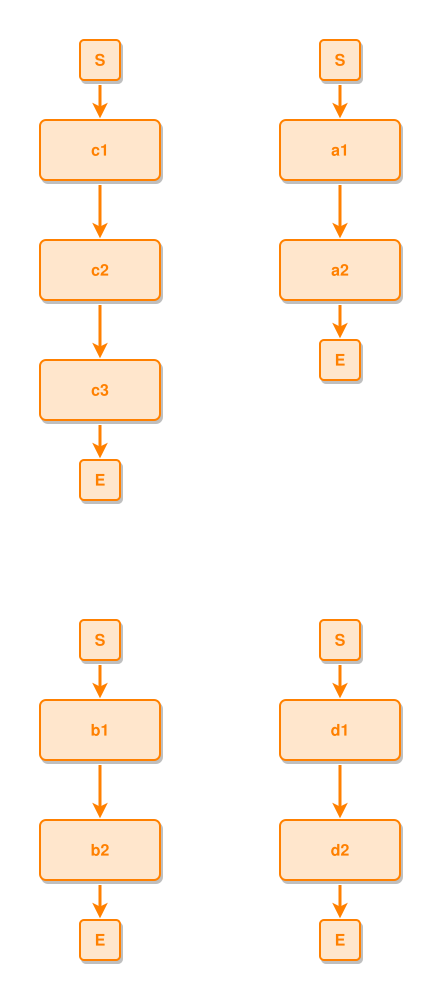
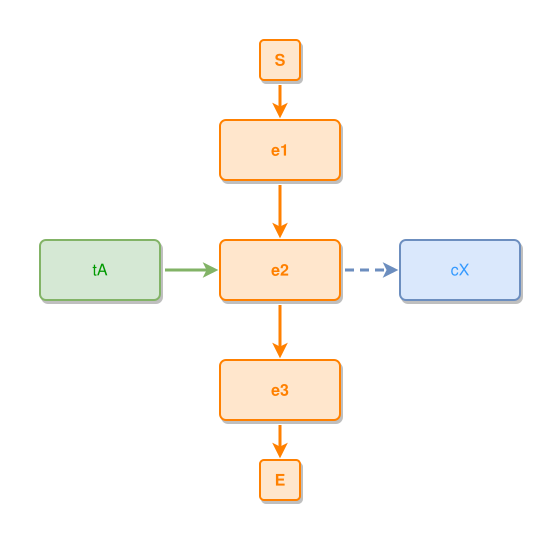

# Layout algorithm — the arrangement anchor

Cases for `layout7.Options.Anchor` (`layout7-engine.md`, Options): a SOFT
arrangement anchor, node id → box centre from a reference layout. Wherever the
engine has a free choice — the order wrapped tiles take, the flank a tied
component rings on when the crossing counts tie — it keeps the arrangement the
anchor had. Positions themselves are still this layout's; nothing is stamped.

This is what the zoom canvas rests on. Every click-path state is laid out with
an anchor built from the all-open layout, so opening one composite does not
re-tile the rest of the picture — *a reader must not be confused by a click*.
Until this lane the option had no worked example anywhere: no CLI flag set it,
no test in this repo exercised it, and its only judge was a corpus aggregate in
a sibling repo.

**How a case is written.** Two ipmt blocks under one heading: the REFERENCE
first, the STATE second. The extractor names them `X.ipmt` and `X-02.ipmt`; the
runner lays `X` out flat, builds the anchor from its box centres, and lays
`X-02` out with it. The rule block follows both, so it applies to the state —
the reference is checked by the global rules alone.

Run by
`go run ./cmd-dev/layout-test-runner --anchor --dir tests/layout-gen-anchor`
against `tests/layout-gen-anchor/*.ipmt`, with rules in
`tests/layout-gen-anchor-rules/*.dsl`. The blocks carry `# ipmt: embed=false`:
`md-embed` renders the flat engine, and for the state fence the flat picture is
exactly the one this case exists to avoid.

## Cases

### a component that grows does not re-tile the ones that did not

Four independent little stories. The reference tiles them two by two: `a` and
`b` on the top row, `c` and `d` below.

```ipmt
# ipmt: embed=false
a1 ::e --> a2 ::e
b1 ::e --> b2 ::e
c1 ::e --> c2 ::e
d1 ::e --> d2 ::e
```

Now `c` gains a step — one click's worth of change in a canvas. Laid out by the
grammar alone, **every component moves**: the taller `c` sorts to the front and
takes the top-left corner, `a` slides right, `b` and `d` drop to a second row
that is now 700px down (flat: `c1` at 40,120 · `a1` at 280,120 · `b1` at
40,700). Nothing about `a`, `b` or `d` changed, and all three are somewhere
else.

With the anchor, they stay: `a` and `b` hold the top row at the exact positions
they had, `d` keeps the second row, and the component that actually changed —
`c` — is the one that moves, to the bottom.

```ipmt
# ipmt: embed=false
a1 ::e --> a2 ::e
b1 ::e --> b2 ::e
c1 ::e --> c2 ::e --> c3 ::e
d1 ::e --> d2 ::e
```



Visual rules:
- Two two-step stories side by side at the top, exactly as in the reference.
- The three-step story is last, not first.

Layout rules:
- `a` and `b` hold the reference's top row; `c`, which grew, goes below `d`.

```ipmdev-layout-rule
@scope local
#a1 has x=40
#a1 has y=120
#b1 has x=280
#b1 has y=120
all #a1,#b1 have same y
#d1 has y=580
#c1 has y=1040
```

### anchoring a layout to itself changes nothing

The soft half of "soft anchor": when the reference IS this layout, every free
choice already agrees with it, so the result is the flat layout box for box.
An anchor that pulled would show up here as drift.

```ipmt
# ipmt: embed=false
e1 ::e --> e2 ::e --> e3 ::e
e2 <-- tA
e2 --> cX ::c
```

The same document again — the comment is there only so the extractor keeps two
fixtures rather than deduplicating them into one:

```ipmt
# ipmt: embed=false
# the reference, once more, as the state
e1 ::e --> e2 ::e --> e3 ::e
e2 <-- tA
e2 --> cX ::c
```



Visual rules:
- The ordinary flat picture: spine down the middle, thing left, concept right.

Layout rules:
- Every box where the flat engine puts it.

```ipmdev-layout-rule
@scope local
#e1 has x=220
#e1 has y=120
#tA has x=40
#tA has y=240
#e2 has x=220
#e2 has y=240
#cX has x=400
#cX has y=240
#e3 has y=360
all #e1,#e2,#e3 have same center-x
```
