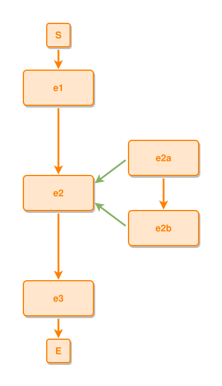
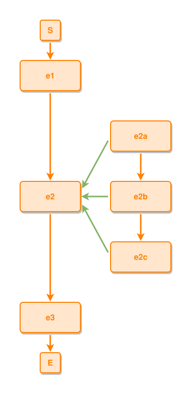

# Layout algorithm — a composite's sub-grid claims its own rows

Cases for `layout7.Options.Containers` (`layout7-engine.md`, Options) run
WITHOUT `Shells`: the members of an open composite get rows of their own, and
everything else in the spine keeps clear of the grid's whole span instead of
tucking in beside it. It is the mode the zoom canvas runs in — ipm-drawio asks
for `Containers` on every state — and the shells lane always draws a shell box
on top of it, so nothing there separates what Containers does from what the
shell's padding does. Here it runs alone.

Flat is the default and the contrast: with Containers off, the spine and a
composite's members share rows, which is compact and reads as though the
members belonged to whichever step happens to sit beside them.

Same executable mechanics as `layout-alg.md`: `ipmdev-layout-rule` blocks are
extracted by `gl:cmd-dev/sync-test-cases` into `tests/layout-gen-containers-rules/*.dsl`
and run by
`go run ./cmd-dev/layout-test-runner --containers --dir tests/layout-gen-containers`
against `tests/layout-gen-containers/*.ipmt`. The blocks carry
`# ipmt: embed=false` — `md-embed` renders the flat engine, and the flat
picture is exactly what these cases are NOT about — so each links the SVG
`ipmsvg-gen` renders from the layout the runner writes.

## Cases

### the successor waits for the whole sub-grid, not for the composite's box

`e2` holds `e2a → e2b`. Flat, the successor `e3` tucks in one row gap under
`e2` (y=360) while `e2b` is still hanging beside it at y=300 — legible here,
misleading in a bigger diagram, because `e3` reads as a sibling of the members.
With Containers the grid owns its rows: `e2` drops to y=300, `e3` to y=480, one
row gap under the LAST member.

```ipmt
# ipmt: embed=false
e1 ::e --> e2 ::e --> e3 ::e
e2 <--::P-- e2a ::e, e2b ::e
e2a --> e2b
```



Visual rules:
- One column of spine events on the left, one column of members on the right.
- No member sits on a row with a spine event that is not its own composite.

Layout rules:
- The composite sits with its grid; the successor clears the grid's last row.
- Flat, for comparison: `e2` y=240, `e2b` y=300, `e3` y=360.

```ipmdev-layout-rule
@scope local
#e2a has y=240
#e2 has y=300
#e2b has y=360
#e3 has y=480
#e3 is below #e2 with gap=120
all #e1,#e2,#e3 have same center-x
all #e2a,#e2b have same center-x
```

### a deeper grid pushes the spine further, row for row

Three members instead of two, and the difference stops being cosmetic. Flat,
the spine and the grid interleave exactly — `e1`/`e2a` on one row, `e2`/`e2b`
on the next, `e3`/`e2c` on the next — so every member is beside a step it has
nothing to do with. With Containers the grid takes rows 240–540 for itself and
the spine steps around it: `e2` centres on the grid, `e3` waits below all of it.

```ipmt
# ipmt: embed=false
e1 ::e --> e2 ::e --> e3 ::e
e2 <--::P-- e2a ::e, e2b ::e, e2c ::e
e2a --> e2b --> e2c
```



Visual rules:
- The three members run down the right column; `e2` sits level with the middle
  one, `e1` above the grid and `e3` below it.

Layout rules:
- The composite is level with its middle member; the successor clears the last.
- Flat, for comparison: `e2` y=240 and `e3` y=360 — level with `e2b` and `e2c`.

```ipmdev-layout-rule
@scope local
#e2a has y=240
#e2b has y=360
#e2c has y=480
#e2 has y=360
#e3 has y=600
all #e2,#e2b have same y
#e3 is below #e2 with gap=180
all #e1,#e2,#e3 have same center-x
```
