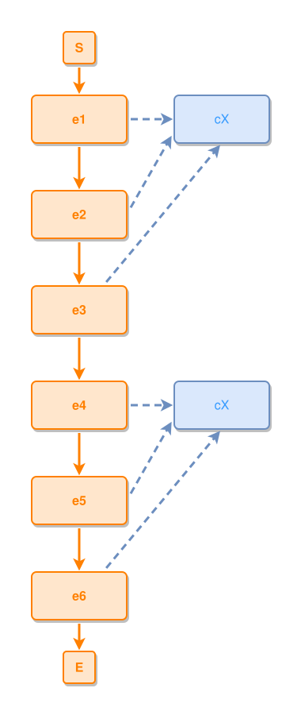
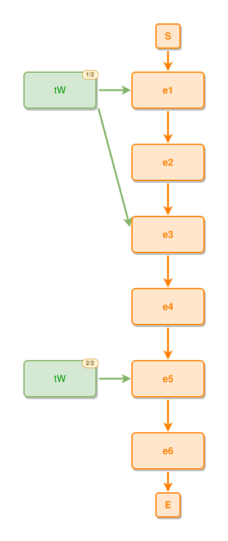
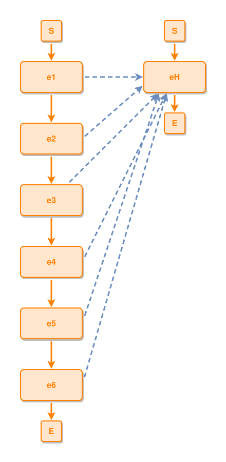
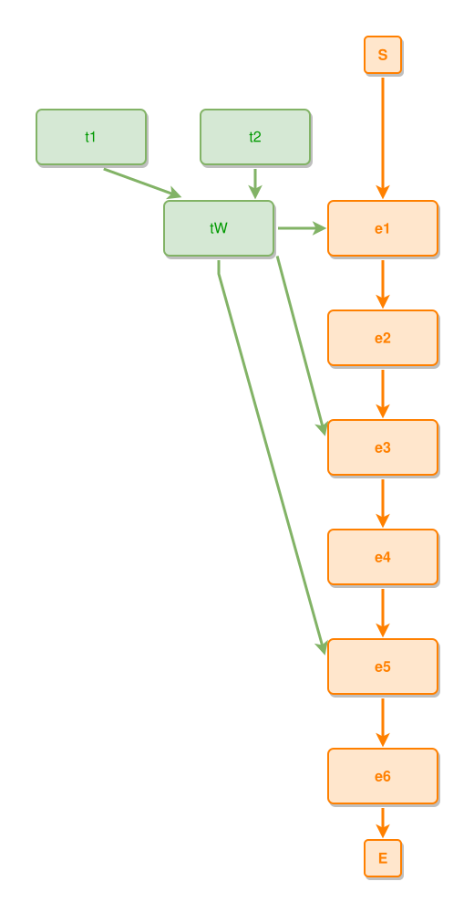
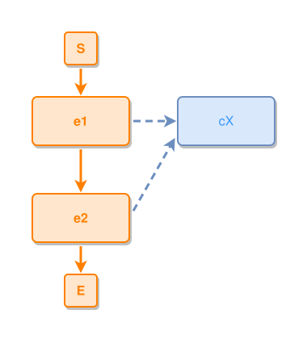
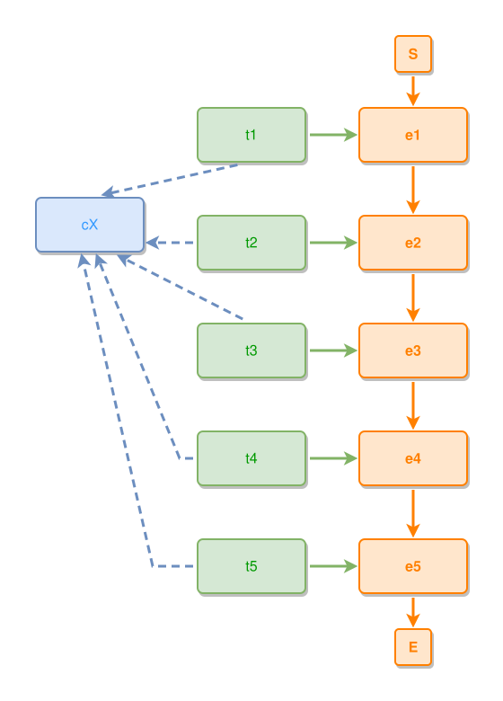

# Layout algorithm — a participant drawn in several places

Cases for `pkg/layoutdupe` (`layout7-engine.md`, "Pre-layout pass: duplication"):
when an edge is long enough that its far end cannot be read from here, the
**participant** at that end is drawn again, next to the users that need it. The
graph never changes — this is a placement decision, like a container shell —
and the engine never changes: the pass rewrites the layout INPUT and `layout7`
runs unmodified.

Three rules decide, and every case below is one of them:

- **kind** — a thing or a concept. Never an event: an event happens once, and
  two boxes reading the same happening say the story forked.
- **role** — not on a leads-to chain, not a part-of parent. Never a step, never
  a whole.
- **distance** — at least one edge longer than `max(2 × the median edge, 320px)`.

And one veto: the rewrite is kept only if the picture does not get worse, in
distance *and* in damage (`layoutcheck`'s findings under its own severity
order). A shorter picture that tangles is refused.

Same executable mechanics as `layout-alg.md`: `ipmdev-layout-rule` blocks are
extracted by `gl:cmd-dev/sync-test-cases` into `tests/layout-gen-dupe-rules/*.dsl`
and run by
`go run ./cmd-dev/layout-test-runner --duplicate --duplicate-min-nodes 1 --dir tests/layout-gen-dupe`
against `tests/layout-gen-dupe/*.ipmt`.

Two things about the lane. The blocks carry `# ipmt: embed=false` — `md-embed`
renders the flat engine, and the flat picture is not the picture under test —
so each case links the SVG `ipmsvg-gen` renders from the layout the runner
writes. And the runner lifts the pass's size gate (`--duplicate-min-nodes 1`):
the shipped default leaves anything under 16 nodes alone, because small real
diagrams gain nothing and pay area for it, but a case has to be small to be
read. Everything else runs exactly as it ships.

**In the picture.** Each place carries the same `2/3` badge the canvas draws —
`ipmsvg` reads `layout.Node.CopyOf`, which the pass stamps on every copy — so a
still diagram says what the canvas says with a click.

**How a rule says "this is drawn twice".** Every place of a participant carries
the same name, and a `#name` selector reaches only the first of them — so the
count is a property: `#cX has places=2` is *drawn in two places*, and
`#cX has places=1` is *drawn once*, which is how the refusals below are pinned.

## Cases

### a concept many events express is drawn beside each group

`cX` is expressed by all six steps of the chain. Drawn once it would sit beside
one of them and the other five would reach across the diagram; drawn twice it
is beside `e1` and beside `e4`, and no edge is long any more (the longest falls
626px → 300px, total length 2838 → 1993).

```ipmt
# ipmt: embed=false
e1 ::e --> e2 ::e --> e3 ::e --> e4 ::e --> e5 ::e --> e6 ::e
e1, e2, e3, e4, e5, e6 --::X--> cX ::c
```



Visual rules:
- Six orange events run down one column; one blue concept `cX` appears TWICE to
  their right, each beside the group of steps it serves, each wearing its place
  badge (`1/2`, `2/2`).
- Every expresses edge is short and none crosses another.

Layout rules:
- `cX` is drawn in two places, both in the same column beside the chain.

```ipmdev-layout-rule
@scope local
#cX has places=2
each type=concept has x=220
all #e1,#e2,#e3,#e4,#e5,#e6 have same center-x
```

### a thing many events use is drawn beside each group

Participation, the other shape: `tW` takes part in the first, third and fifth
step. The copies land beside `e1` and beside `e5`, on the flank the thing band
already owns.

```ipmt
# ipmt: embed=false
e1 ::e --> e2 ::e --> e3 ::e --> e4 ::e --> e5 ::e --> e6 ::e
tW --::P--> e1, e3, e5
```



Visual rules:
- The chain runs down the middle; the green thing `tW` appears twice on its
  left, once high and once low.

Layout rules:
- `tW` is drawn in two places, both in the thing band left of the chain.

```ipmdev-layout-rule
@scope local
#tW has places=2
each type=thing has x=40
all #e1,#e2,#e3,#e4,#e5,#e6 have same center-x
```

### an event is never drawn twice

The same shape as the first case with the hub typed `::e` — a definition the
extraction wrote as an event, which is common in imported corpora. It is not
copied, however far its users sit: an event happens once, and a second box of it
would read as a fork in the story that is not there.

```ipmt
# ipmt: embed=false
e1 ::e --> e2 ::e --> e3 ::e --> e4 ::e --> e5 ::e --> e6 ::e
e1, e2, e3, e4, e5, e6 --::X--> eH ::e
```



Visual rules:
- `eH` is orange and appears exactly once, right of the chain.

Layout rules:
- One place, whatever the distance.

```ipmdev-layout-rule
@scope local
#eH has places=1
```

### a whole is never drawn twice

The previous thing case with two parts added: `tW` is now the whole of `t1` and
`t2`. Kind still allows it — it is a thing — but role does not: forking a
container forks the tree, so `tW` stays in one place and the chain comes to it.

```ipmt
# ipmt: embed=false
e1 ::e --> e2 ::e --> e3 ::e --> e4 ::e --> e5 ::e --> e6 ::e
tW --::P--> e1, e3, e5
t1 --::P--> tW
t2 --::P--> tW
```



Visual rules:
- `tW` appears once, with `t1` and `t2` above it; the chain is to its right.

Layout rules:
- One place for the whole, and its parts sit with it.

```ipmdev-layout-rule
@scope local
#tW has places=1
#t1 has places=1
#t2 has places=1
```

### nothing is copied when nothing is far

Two steps and the concept they both express: every edge is short, so there is
nothing to answer. The pass runs and decides to do nothing — which is the
common case, and the reason it can be left on.

```ipmt
# ipmt: embed=false
e1 ::e --> e2 ::e
e1, e2 --::X--> cX ::c
```



Visual rules:
- Two events, one concept, three short edges.

Layout rules:
- One place for `cX`.

```ipmdev-layout-rule
@scope local
#cX has places=1
all #e1,#e2 have same center-x
```

### a shorter picture that would tangle is refused

Five steps, each with its own thing, and every thing expressing `cX`. Copying
`cX` shortens the diagram — total length 2732 → 2411, the longest edge
420px → 316px, no edge left too long — and is still refused, because the
rewritten layout routes an edge THROUGH a box where the first one had none.
Damage outranks distance: `layoutcheck.Regressed` is the same rule the corpus
ratchet gates on.

```ipmt
# ipmt: embed=false
e1 ::e --> e2 ::e --> e3 ::e --> e4 ::e --> e5 ::e
e1 <-- t1
e2 <-- t2
e3 <-- t3
e4 <-- t4
e5 <-- t5
t1, t2, t3, t4, t5 --::X--> cX ::c
```



Visual rules:
- One `cX`, one column of things, one column of events: the single-placement
  layout, kept.

Layout rules:
- One place for `cX` — the pass planned copies and threw them away.

```ipmdev-layout-rule
@scope local
#cX has places=1
```
