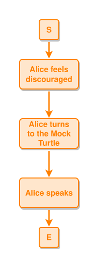
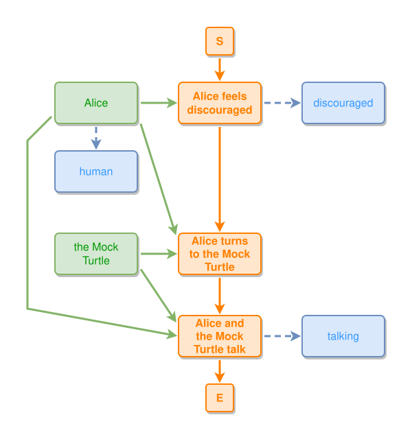
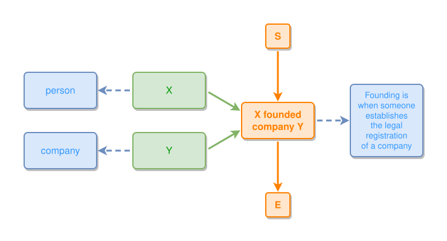
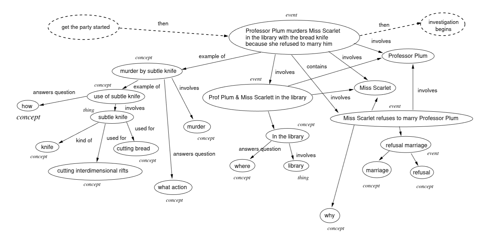
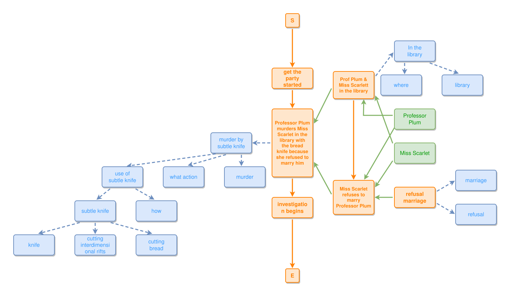
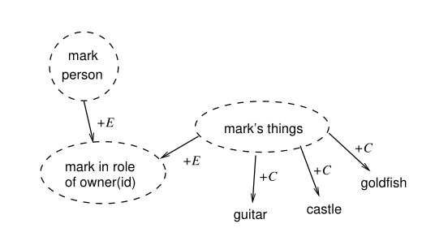
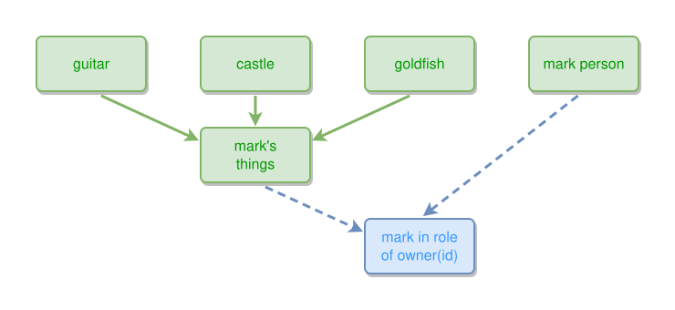

# Example

Various examples I found in [Mark Burgess](https://markburgess.org/) work.

## Mark's 25-08-24 medium post

Designing Nodes and Arrows in Knowledge Graphs with Semantic Spacetime, Mark Burgess, 2025, Aug 24, [mark-burgess-oslo-mb.medium.com](https://mark-burgess-oslo-mb.medium.com/designing-nodes-and-arrows-in-knowledge-graphs-with-semantic-spacetime-0992b9cae595)

```ipmt
# Alice's story
Alice feels discouraged ::e e1::a
Alice turns to the Mock Turtle ::e e2::a
Alice speaks ::e e3::a

e1 --> e2 --> e3
```
<!-- ipm-svg id=100 hash=03ec3dda -->


Alice appears in all three frames, which looks like repetition until you read what
Mark says about it:

> Alice is not a statue, frozen in time. The Alice in the first event is not the same
> Alice as in the second event. She (the state of Alice) has moved on. The concept of
> Alice is the same in each frame, but it's not the concept of Alice that feels or speaks.

In ipm that comes out as one `Alice` thing - a worldline, not three copies - taking part in
every frame. The state that moved on hangs on the frames: `e1 --> discouraged ::c`, because
`Alice --> discouraged ::c` would make her discouraged in every frame she appears in.

The invariance Mark points at is the **thing node itself**. It needs no "concept of Alice"
beside it - a concept only one thing ever expresses carries no story, which is his own
objection to proper-name nodes. What a concept adds is what she is *like*: `human ::c`, which
everything else that is one expresses too. And it cannot feel or speak, because a concept never
leads to an event nor takes part in one.

```ipmt
# Alice's story, with the participants and what each frame expresses
e1::a Alice feels discouraged ::e
  --> e2::a Alice turns to the Mock Turtle ::e
  --> e3::a Alice and the Mock Turtle talk ::e

# one worldline through the frames, not one Alice per frame
Alice ::t --> e1, e2, e3
the Mock Turtle ::t --> e2, e3

# what each frame is about: a property of the frame, not of Alice
e1 --> discouraged ::c
e3 --> talking ::c

# what she is like - a property others share, not who she is
Alice ::t --> human ::c
```
<!-- ipm-svg id=105 hash=c76a75fd -->


```ipmt
# Company founding
X ::t --> X founded company Y ::e fe::a
Y ::t --> fe
X ::t --> person ::c
Y ::t --> company ::c
fe --> Founding is when someone establishes the legal registration of a company ::c
```
<!-- ipm-svg id=110 hash=cbed0904 -->


## Murder Mystery, June 2025



Source: Figure 2 of Agent Semantics, Semantic Spacetime, and Graphical Reasoning ([researchgate.net link](https://www.researchgate.net/publication/392507642)) paper by Mark Burgess.

```ipmt
get the party started ::e
  --then--> murder-e::a Professor Plum murders Miss Scarlet in the library with the bread knife because she refused to marry him ::e
  --then--> investigation begins ::e


# fix: subtle knife ::t -> ::c
murder-e --"example of"--> murder-sk::a murder by subtle knife ::c
  --"example of"--> use-sk::a use of subtle knife ::c
  --"involves"--> sk::a subtle knife ::c
  --"kind of"--> knife ::c

murder-sk --"answers question"--> what action ::c
murder-sk --"involves"--> murder ::c
use-sk --"answers question"--> how ::c
sk --"used for"--> cutting interdimensional rifts ::c
sk --"used for"--> cutting bread ::c

murder-e <--::P involves-- library-ppms::a Prof Plum & Miss Scarlett in the library ::e
  --> In the library ::c
  --"answers question"--> where ::c

# fix: library ::t -> ::c
In the library --"involves"--> library ::c

murder-e <--::P contains-- refusal-mspp::a Miss Scarlet refuses to marry Professor Plum ::e
  <--::P-- refusal marriage ::e
  --> marriage ::c
refusal marriage --> refusal ::c

# fix: add leads-to
library-ppms --> refusal-mspp

# change: change involves/contains to part-of
# change: hide explicit Professor Plum --> skip murder-e
# change: hide explicit Miss Scarlet --> skip murder-e
Professor Plum ::t --> library-ppms
Professor Plum ::t --> refusal-mspp
Miss Scarlet ::t --> library-ppms
Miss Scarlet ::t --> refusal-mspp
```
<!-- ipm-svg id=120 hash=98cd652e -->



## Ownership, June 2025



Source: Figure 3 of  Agent Semantics, Semantic Spacetime, and Graphical Reasoning ([researchgate.net link](https://www.researchgate.net/publication/392507642)) paper by Mark Burgess.

```ipmt
guitar ::t, castle ::t, goldfish ::t --> mark's things ::t
mark's things ::t --> mark in role of owner(id) ::c <-- mark person ::t
```
<!-- ipm-svg id=130 hash=a3d16ddd -->

