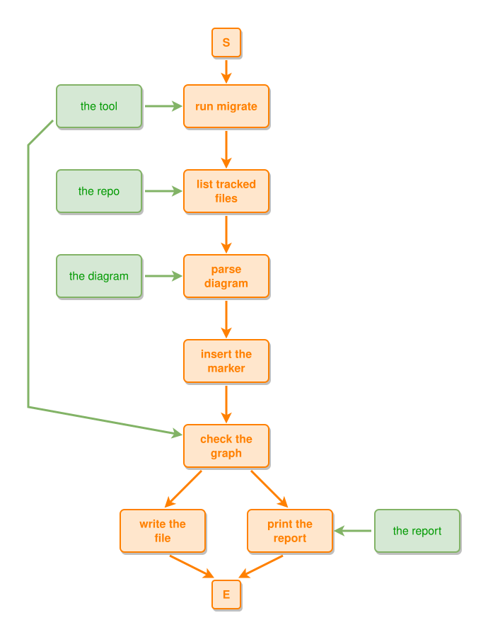

<!-- AUTO-GENERATED FILE - DO NOT EDIT -->
<!-- Generated by: gen-test-md -->
<!-- Command: go run ./cmd-dev/gen-test-md -->

# flow

> **⚠️ Warning:** This file is auto-generated. Manual changes will be lost when tests are regenerated.

**Source:** gl:docs/dev-tools/ipmt-migrate.md#L164-L179 | [docs/dev-tools/ipmt-migrate.md](../../../docs/dev-tools/ipmt-migrate.md#flow)

## ipmt Content

```ipmt
# the migration of one repo
run migrate
list tracked files
parse diagram
insert the marker
check the graph
write the file
print the report
the tool ::t --> run migrate
the repo ::t --> list tracked files
run migrate --> list tracked files --> parse diagram --> insert the marker --> check the graph --> write the file
check the graph --> print the report
the tool ::t --> check the graph
the diagram ::t --> parse diagram
the report ::t --> print the report
```

## Generated Files

- [flow.ipmt](flow.ipmt) - ipmt input
- [flow.json](flow.json) - Parsed structure
- [flow.layout.json](flow.layout.json) - Layout coordinates
- [flow.ipm.svg](flow.ipm.svg) - Rendered diagram

## Rendered Diagram



This test case was automatically generated from the specification document.

The ipmt code block was extracted using [sync-test-cases](../../../docs/dev/testing.md) and saved to [flow.ipmt](flow.ipmt), then parsed into the [JSON structure](flow.json) and laid out into [layout coordinates](flow.layout.json). The [SVG diagram](flow.ipm.svg) was rendered using [ipmsvg-gen](../../../docs/ipmsvg-gen.md).
