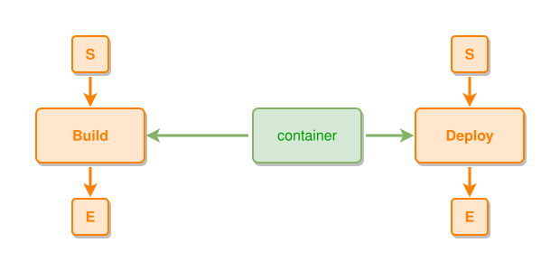

<!-- AUTO-GENERATED FILE - DO NOT EDIT -->
<!-- Generated by: gen-test-md -->
<!-- Command: go run ./cmd-dev/gen-test-md -->

# no-duplicate-edge-between-the-same-nodes

> **⚠️ Warning:** This file is auto-generated. Manual changes will be lost when tests are regenerated.

**Source:** gl:docs/how-to-model.md#L212-L214 | [docs/how-to-model.md](../../../docs/how-to-model.md#no-duplicate-edge-between-the-same-nodes)

## ipmt Content

```ipmt
container --> Deploy ::e
container --> Build ::e
```

## Generated Files

- [no-duplicate-edge-between-the-same-nodes.ipmt](no-duplicate-edge-between-the-same-nodes.ipmt) - ipmt input
- [no-duplicate-edge-between-the-same-nodes.json](no-duplicate-edge-between-the-same-nodes.json) - Parsed structure
- [no-duplicate-edge-between-the-same-nodes.layout.json](no-duplicate-edge-between-the-same-nodes.layout.json) - Layout coordinates
- [no-duplicate-edge-between-the-same-nodes.ipm.svg](no-duplicate-edge-between-the-same-nodes.ipm.svg) - Rendered diagram

## Rendered Diagram



This test case was automatically generated from the specification document.

The ipmt code block was extracted using [sync-test-cases](../../../docs/dev/testing.md) and saved to [no-duplicate-edge-between-the-same-nodes.ipmt](no-duplicate-edge-between-the-same-nodes.ipmt), then parsed into the [JSON structure](no-duplicate-edge-between-the-same-nodes.json) and laid out into [layout coordinates](no-duplicate-edge-between-the-same-nodes.layout.json). The [SVG diagram](no-duplicate-edge-between-the-same-nodes.ipm.svg) was rendered using [ipmsvg-gen](../../../docs/ipmsvg-gen.md).
