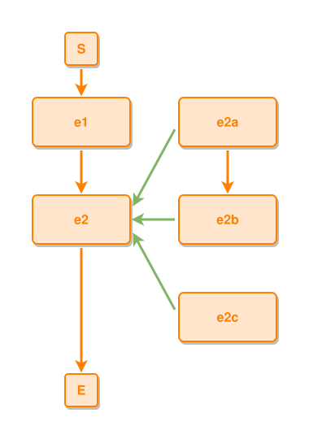

<!-- AUTO-GENERATED FILE - DO NOT EDIT -->
<!-- Generated by: gen-test-md -->
<!-- Command: go run ./cmd-dev/gen-test-md -->

# v7p3-the-event-skeleton-leads-to-runs-down-part-of-indents-right-forks-spread-sy

> **⚠️ Warning:** This file is auto-generated. Manual changes will be lost when tests are regenerated.

**Source:** gl:docs/dev/layout-gen/layout-principles.md#L302-L307 | [docs/dev/layout-gen/layout-principles.md](../../../docs/dev/layout-gen/layout-principles.md#v7p3-the-event-skeleton-leads-to-runs-down-part-of-indents-right-forks-spread-symmetrically)

## ipmt Content

```ipmt
e1 --> e2
e2b --::P--> e2
e2a --::P--> e2
e2a --> e2b
e2c --::P--> e2
```

## Generated Files

- [v7p3-the-event-skeleton-leads-to-runs-down-part-of-indents-right-forks-spread-sy.ipmt](v7p3-the-event-skeleton-leads-to-runs-down-part-of-indents-right-forks-spread-sy.ipmt) - ipmt input
- [v7p3-the-event-skeleton-leads-to-runs-down-part-of-indents-right-forks-spread-sy.json](v7p3-the-event-skeleton-leads-to-runs-down-part-of-indents-right-forks-spread-sy.json) - Parsed structure
- [v7p3-the-event-skeleton-leads-to-runs-down-part-of-indents-right-forks-spread-sy.layout.json](v7p3-the-event-skeleton-leads-to-runs-down-part-of-indents-right-forks-spread-sy.layout.json) - Layout coordinates
- [v7p3-the-event-skeleton-leads-to-runs-down-part-of-indents-right-forks-spread-sy.ipm.svg](v7p3-the-event-skeleton-leads-to-runs-down-part-of-indents-right-forks-spread-sy.ipm.svg) - Rendered diagram

## Rendered Diagram



This test case was automatically generated from the specification document.

The ipmt code block was extracted using [sync-test-cases](../../../docs/dev/testing.md) and saved to [v7p3-the-event-skeleton-leads-to-runs-down-part-of-indents-right-forks-spread-sy.ipmt](v7p3-the-event-skeleton-leads-to-runs-down-part-of-indents-right-forks-spread-sy.ipmt), then parsed into the [JSON structure](v7p3-the-event-skeleton-leads-to-runs-down-part-of-indents-right-forks-spread-sy.json) and laid out into [layout coordinates](v7p3-the-event-skeleton-leads-to-runs-down-part-of-indents-right-forks-spread-sy.layout.json). The [SVG diagram](v7p3-the-event-skeleton-leads-to-runs-down-part-of-indents-right-forks-spread-sy.ipm.svg) was rendered using [ipmsvg-gen](../../../docs/ipmsvg-gen.md).
