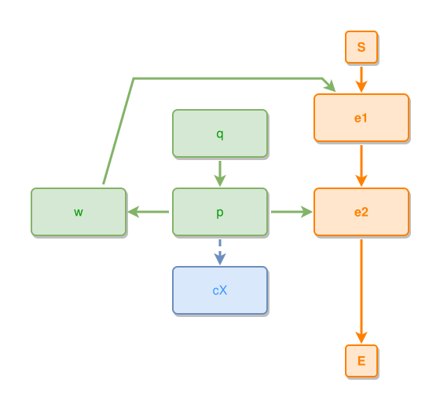

<!-- AUTO-GENERATED FILE - DO NOT EDIT -->
<!-- Generated by: gen-test-md -->
<!-- Command: go run ./cmd-dev/gen-test-md -->

# v7p4-aux-attaches-in-groups-on-the-events-row-wholes-outward-parts-above-concept

> **⚠️ Warning:** This file is auto-generated. Manual changes will be lost when tests are regenerated.

**Source:** gl:docs/dev/layout-gen/layout-principles.md#L524-L530 | [docs/dev/layout-gen/layout-principles.md](../../../docs/dev/layout-gen/layout-principles.md#v7p4-aux-attaches-in-groups-on-the-events-row-wholes-outward-parts-above-concepts-down)

## ipmt Content

```ipmt
e1 ::e --> e2 ::e
w ::t --> e1
p ::t --> w
p --> e2
p --> cX ::c
q ::t --> p
```

## Generated Files

- [v7p4-aux-attaches-in-groups-on-the-events-row-wholes-outward-parts-above-concept.ipmt](v7p4-aux-attaches-in-groups-on-the-events-row-wholes-outward-parts-above-concept.ipmt) - ipmt input
- [v7p4-aux-attaches-in-groups-on-the-events-row-wholes-outward-parts-above-concept.json](v7p4-aux-attaches-in-groups-on-the-events-row-wholes-outward-parts-above-concept.json) - Parsed structure
- [v7p4-aux-attaches-in-groups-on-the-events-row-wholes-outward-parts-above-concept.layout.json](v7p4-aux-attaches-in-groups-on-the-events-row-wholes-outward-parts-above-concept.layout.json) - Layout coordinates
- [v7p4-aux-attaches-in-groups-on-the-events-row-wholes-outward-parts-above-concept.ipm.svg](v7p4-aux-attaches-in-groups-on-the-events-row-wholes-outward-parts-above-concept.ipm.svg) - Rendered diagram

## Rendered Diagram



This test case was automatically generated from the specification document.

The ipmt code block was extracted using [sync-test-cases](../../../docs/dev/testing.md) and saved to [v7p4-aux-attaches-in-groups-on-the-events-row-wholes-outward-parts-above-concept.ipmt](v7p4-aux-attaches-in-groups-on-the-events-row-wholes-outward-parts-above-concept.ipmt), then parsed into the [JSON structure](v7p4-aux-attaches-in-groups-on-the-events-row-wholes-outward-parts-above-concept.json) and laid out into [layout coordinates](v7p4-aux-attaches-in-groups-on-the-events-row-wholes-outward-parts-above-concept.layout.json). The [SVG diagram](v7p4-aux-attaches-in-groups-on-the-events-row-wholes-outward-parts-above-concept.ipm.svg) was rendered using [ipmsvg-gen](../../../docs/ipmsvg-gen.md).
