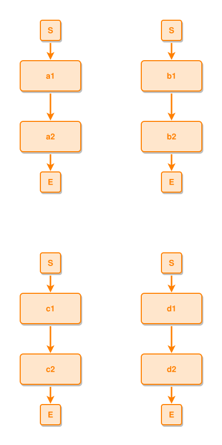

<!-- AUTO-GENERATED FILE - DO NOT EDIT -->
<!-- Generated by: gen-test-md -->
<!-- Command: go run ./cmd-dev/gen-test-md -->

# a-component-that-grows-does-not-re-tile-the-ones-that-did-not

> **⚠️ Warning:** This file is auto-generated. Manual changes will be lost when tests are regenerated.

**Source:** gl:docs/dev/layout-gen/layout-alg-anchor.md#L37-L42 | [docs/dev/layout-gen/layout-alg-anchor.md](../../docs/dev/layout-gen/layout-alg-anchor.md#a-component-that-grows-does-not-re-tile-the-ones-that-did-not)

## ipmt Content

```ipmt
# ipmt: embed=false
a1 --> a2
b1 --> b2
c1 --> c2
d1 --> d2
```

## Generated Files

- [a-component-that-grows-does-not-re-tile-the-ones-that-did-not.ipmt](a-component-that-grows-does-not-re-tile-the-ones-that-did-not.ipmt) - ipmt input
- [a-component-that-grows-does-not-re-tile-the-ones-that-did-not.json](a-component-that-grows-does-not-re-tile-the-ones-that-did-not.json) - Parsed structure
- [a-component-that-grows-does-not-re-tile-the-ones-that-did-not.layout.json](a-component-that-grows-does-not-re-tile-the-ones-that-did-not.layout.json) - Layout coordinates
- [a-component-that-grows-does-not-re-tile-the-ones-that-did-not.ipm.svg](a-component-that-grows-does-not-re-tile-the-ones-that-did-not.ipm.svg) - Rendered diagram

## Rendered Diagram



This test case was automatically generated from the specification document.

The ipmt code block was extracted using [sync-test-cases](../../docs/dev/testing.md) and saved to [a-component-that-grows-does-not-re-tile-the-ones-that-did-not.ipmt](a-component-that-grows-does-not-re-tile-the-ones-that-did-not.ipmt), then parsed into the [JSON structure](a-component-that-grows-does-not-re-tile-the-ones-that-did-not.json) and laid out into [layout coordinates](a-component-that-grows-does-not-re-tile-the-ones-that-did-not.layout.json). The [SVG diagram](a-component-that-grows-does-not-re-tile-the-ones-that-did-not.ipm.svg) was rendered using [ipmsvg-gen](../../docs/ipmsvg-gen.md).
