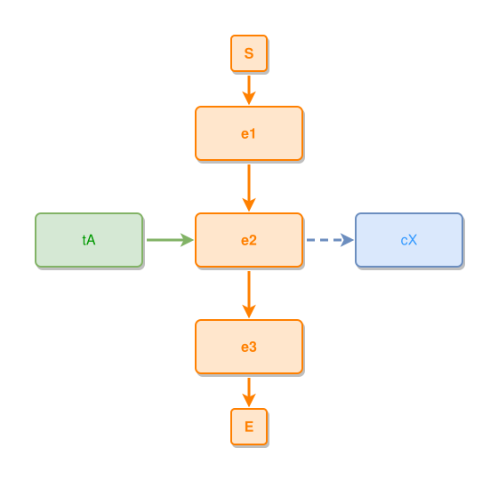

<!-- AUTO-GENERATED FILE - DO NOT EDIT -->
<!-- Generated by: gen-test-md -->
<!-- Command: go run ./cmd-dev/gen-test-md -->

# anchoring-a-layout-to-itself-changes-nothing-02

> **⚠️ Warning:** This file is auto-generated. Manual changes will be lost when tests are regenerated.

**Source:** gl:docs/dev/layout-gen/layout-alg-anchor.md#L100-L105 | [docs/dev/layout-gen/layout-alg-anchor.md](../../docs/dev/layout-gen/layout-alg-anchor.md#anchoring-a-layout-to-itself-changes-nothing)

## ipmt Content

```ipmt
# ipmt: embed=false
# the reference, once more, as the state
e1 --> e2 --> e3
e2 <-- tA ::t
e2 --> cX ::c
```

## Generated Files

- [anchoring-a-layout-to-itself-changes-nothing-02.ipmt](anchoring-a-layout-to-itself-changes-nothing-02.ipmt) - ipmt input
- [anchoring-a-layout-to-itself-changes-nothing-02.json](anchoring-a-layout-to-itself-changes-nothing-02.json) - Parsed structure
- [anchoring-a-layout-to-itself-changes-nothing-02.layout.json](anchoring-a-layout-to-itself-changes-nothing-02.layout.json) - Layout coordinates
- [anchoring-a-layout-to-itself-changes-nothing-02.ipm.svg](anchoring-a-layout-to-itself-changes-nothing-02.ipm.svg) - Rendered diagram

## Rendered Diagram



This test case was automatically generated from the specification document.

The ipmt code block was extracted using [sync-test-cases](../../docs/dev/testing.md) and saved to [anchoring-a-layout-to-itself-changes-nothing-02.ipmt](anchoring-a-layout-to-itself-changes-nothing-02.ipmt), then parsed into the [JSON structure](anchoring-a-layout-to-itself-changes-nothing-02.json) and laid out into [layout coordinates](anchoring-a-layout-to-itself-changes-nothing-02.layout.json). The [SVG diagram](anchoring-a-layout-to-itself-changes-nothing-02.ipm.svg) was rendered using [ipmsvg-gen](../../docs/ipmsvg-gen.md).
