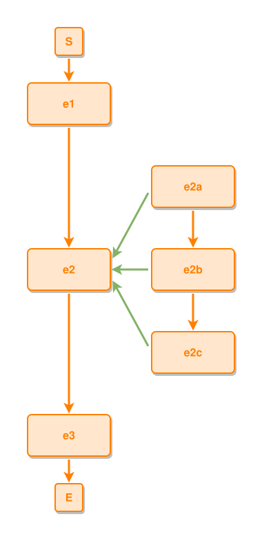

<!-- AUTO-GENERATED FILE - DO NOT EDIT -->
<!-- Generated by: gen-test-md -->
<!-- Command: go run ./cmd-dev/gen-test-md -->

# a-deeper-grid-pushes-the-spine-further-row-for-row

> **⚠️ Warning:** This file is auto-generated. Manual changes will be lost when tests are regenerated.

**Source:** gl:docs/dev/layout-gen/layout-alg-containers.md#L71-L75 | [docs/dev/layout-gen/layout-alg-containers.md](../../docs/dev/layout-gen/layout-alg-containers.md#a-deeper-grid-pushes-the-spine-further-row-for-row)

## ipmt Content

```ipmt
# ipmt: embed=false
e1 ::e --> e2 ::e --> e3 ::e
e2 <--::P-- e2a ::e, e2b ::e, e2c ::e
e2a --> e2b --> e2c
```

## Generated Files

- [a-deeper-grid-pushes-the-spine-further-row-for-row.ipmt](a-deeper-grid-pushes-the-spine-further-row-for-row.ipmt) - ipmt input
- [a-deeper-grid-pushes-the-spine-further-row-for-row.json](a-deeper-grid-pushes-the-spine-further-row-for-row.json) - Parsed structure
- [a-deeper-grid-pushes-the-spine-further-row-for-row.layout.json](a-deeper-grid-pushes-the-spine-further-row-for-row.layout.json) - Layout coordinates
- [a-deeper-grid-pushes-the-spine-further-row-for-row.ipm.svg](a-deeper-grid-pushes-the-spine-further-row-for-row.ipm.svg) - Rendered diagram

## Rendered Diagram



This test case was automatically generated from the specification document.

The ipmt code block was extracted using [sync-test-cases](../../docs/dev/testing.md) and saved to [a-deeper-grid-pushes-the-spine-further-row-for-row.ipmt](a-deeper-grid-pushes-the-spine-further-row-for-row.ipmt), then parsed into the [JSON structure](a-deeper-grid-pushes-the-spine-further-row-for-row.json) and laid out into [layout coordinates](a-deeper-grid-pushes-the-spine-further-row-for-row.layout.json). The [SVG diagram](a-deeper-grid-pushes-the-spine-further-row-for-row.ipm.svg) was rendered using [ipmsvg-gen](../../docs/ipmsvg-gen.md).
