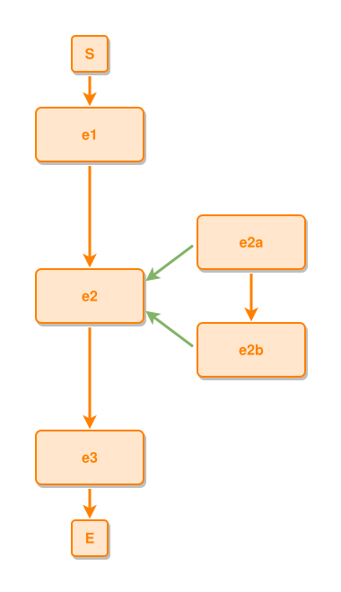

<!-- AUTO-GENERATED FILE - DO NOT EDIT -->
<!-- Generated by: gen-test-md -->
<!-- Command: go run ./cmd-dev/gen-test-md -->

# the-successor-waits-for-the-whole-sub-grid-not-for-the-composites-box

> **⚠️ Warning:** This file is auto-generated. Manual changes will be lost when tests are regenerated.

**Source:** gl:docs/dev/layout-gen/layout-alg-containers.md#L35-L39 | [docs/dev/layout-gen/layout-alg-containers.md](../../docs/dev/layout-gen/layout-alg-containers.md#the-successor-waits-for-the-whole-sub-grid-not-for-the-composites-box)

## ipmt Content

```ipmt
# ipmt: embed=false
e1 --> e2 --> e3
e2 <--::P-- e2a, e2b
e2a --> e2b
```

## Generated Files

- [the-successor-waits-for-the-whole-sub-grid-not-for-the-composites-box.ipmt](the-successor-waits-for-the-whole-sub-grid-not-for-the-composites-box.ipmt) - ipmt input
- [the-successor-waits-for-the-whole-sub-grid-not-for-the-composites-box.json](the-successor-waits-for-the-whole-sub-grid-not-for-the-composites-box.json) - Parsed structure
- [the-successor-waits-for-the-whole-sub-grid-not-for-the-composites-box.layout.json](the-successor-waits-for-the-whole-sub-grid-not-for-the-composites-box.layout.json) - Layout coordinates
- [the-successor-waits-for-the-whole-sub-grid-not-for-the-composites-box.ipm.svg](the-successor-waits-for-the-whole-sub-grid-not-for-the-composites-box.ipm.svg) - Rendered diagram

## Rendered Diagram



This test case was automatically generated from the specification document.

The ipmt code block was extracted using [sync-test-cases](../../docs/dev/testing.md) and saved to [the-successor-waits-for-the-whole-sub-grid-not-for-the-composites-box.ipmt](the-successor-waits-for-the-whole-sub-grid-not-for-the-composites-box.ipmt), then parsed into the [JSON structure](the-successor-waits-for-the-whole-sub-grid-not-for-the-composites-box.json) and laid out into [layout coordinates](the-successor-waits-for-the-whole-sub-grid-not-for-the-composites-box.layout.json). The [SVG diagram](the-successor-waits-for-the-whole-sub-grid-not-for-the-composites-box.ipm.svg) was rendered using [ipmsvg-gen](../../docs/ipmsvg-gen.md).
