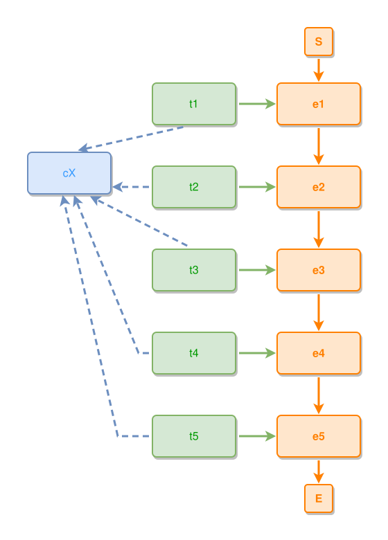

<!-- AUTO-GENERATED FILE - DO NOT EDIT -->
<!-- Generated by: gen-test-md -->
<!-- Command: go run ./cmd-dev/gen-test-md -->

# a-shorter-picture-that-would-tangle-is-refused

> **⚠️ Warning:** This file is auto-generated. Manual changes will be lost when tests are regenerated.

**Source:** gl:docs/dev/layout-gen/layout-alg-dupe.md#L197-L205 | [docs/dev/layout-gen/layout-alg-dupe.md](../../docs/dev/layout-gen/layout-alg-dupe.md#a-shorter-picture-that-would-tangle-is-refused)

## ipmt Content

```ipmt
# ipmt: embed=false
e1 --> e2 --> e3 --> e4 --> e5
e1 <-- t1 ::t
e2 <-- t2 ::t
e3 <-- t3 ::t
e4 <-- t4 ::t
e5 <-- t5 ::t
t1 ::t, t2 ::t, t3 ::t, t4 ::t, t5 ::t --::X--> cX ::c
```

## Generated Files

- [a-shorter-picture-that-would-tangle-is-refused.ipmt](a-shorter-picture-that-would-tangle-is-refused.ipmt) - ipmt input
- [a-shorter-picture-that-would-tangle-is-refused.json](a-shorter-picture-that-would-tangle-is-refused.json) - Parsed structure
- [a-shorter-picture-that-would-tangle-is-refused.layout.json](a-shorter-picture-that-would-tangle-is-refused.layout.json) - Layout coordinates
- [a-shorter-picture-that-would-tangle-is-refused.ipm.svg](a-shorter-picture-that-would-tangle-is-refused.ipm.svg) - Rendered diagram

## Rendered Diagram



This test case was automatically generated from the specification document.

The ipmt code block was extracted using [sync-test-cases](../../docs/dev/testing.md) and saved to [a-shorter-picture-that-would-tangle-is-refused.ipmt](a-shorter-picture-that-would-tangle-is-refused.ipmt), then parsed into the [JSON structure](a-shorter-picture-that-would-tangle-is-refused.json) and laid out into [layout coordinates](a-shorter-picture-that-would-tangle-is-refused.layout.json). The [SVG diagram](a-shorter-picture-that-would-tangle-is-refused.ipm.svg) was rendered using [ipmsvg-gen](../../docs/ipmsvg-gen.md).
