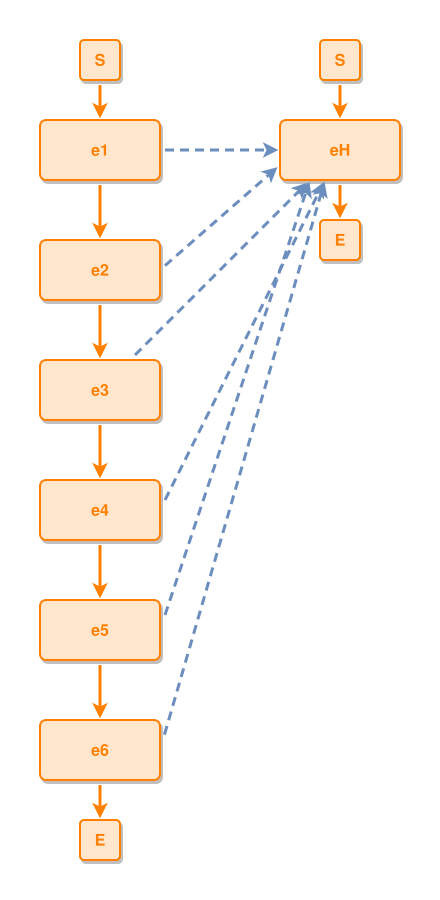

<!-- AUTO-GENERATED FILE - DO NOT EDIT -->
<!-- Generated by: gen-test-md -->
<!-- Command: go run ./cmd-dev/gen-test-md -->

# an-event-is-never-drawn-twice

> **⚠️ Warning:** This file is auto-generated. Manual changes will be lost when tests are regenerated.

**Source:** gl:docs/dev/layout-gen/layout-alg-dupe.md#L109-L112 | [docs/dev/layout-gen/layout-alg-dupe.md](../../docs/dev/layout-gen/layout-alg-dupe.md#an-event-is-never-drawn-twice)

## ipmt Content

```ipmt
# ipmt: embed=false
e1 ::e --> e2 ::e --> e3 ::e --> e4 ::e --> e5 ::e --> e6 ::e
e1, e2, e3, e4, e5, e6 --::X--> eH ::e
```

## Generated Files

- [an-event-is-never-drawn-twice.ipmt](an-event-is-never-drawn-twice.ipmt) - ipmt input
- [an-event-is-never-drawn-twice.json](an-event-is-never-drawn-twice.json) - Parsed structure
- [an-event-is-never-drawn-twice.layout.json](an-event-is-never-drawn-twice.layout.json) - Layout coordinates
- [an-event-is-never-drawn-twice.ipm.svg](an-event-is-never-drawn-twice.ipm.svg) - Rendered diagram

## Rendered Diagram



This test case was automatically generated from the specification document.

The ipmt code block was extracted using [sync-test-cases](../../docs/dev/testing.md) and saved to [an-event-is-never-drawn-twice.ipmt](an-event-is-never-drawn-twice.ipmt), then parsed into the [JSON structure](an-event-is-never-drawn-twice.json) and laid out into [layout coordinates](an-event-is-never-drawn-twice.layout.json). The [SVG diagram](an-event-is-never-drawn-twice.ipm.svg) was rendered using [ipmsvg-gen](../../docs/ipmsvg-gen.md).
