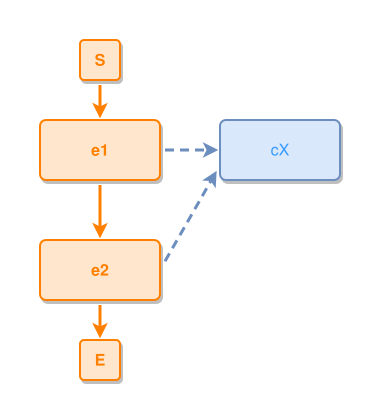

<!-- AUTO-GENERATED FILE - DO NOT EDIT -->
<!-- Generated by: gen-test-md -->
<!-- Command: go run ./cmd-dev/gen-test-md -->

# nothing-is-copied-when-nothing-is-far

> **⚠️ Warning:** This file is auto-generated. Manual changes will be lost when tests are regenerated.

**Source:** gl:docs/dev/layout-gen/layout-alg-dupe.md#L163-L166 | [docs/dev/layout-gen/layout-alg-dupe.md](../../docs/dev/layout-gen/layout-alg-dupe.md#nothing-is-copied-when-nothing-is-far)

## ipmt Content

```ipmt
# ipmt: embed=false
e1 ::e --> e2 ::e
e1, e2 --::X--> cX ::c
```

## Generated Files

- [nothing-is-copied-when-nothing-is-far.ipmt](nothing-is-copied-when-nothing-is-far.ipmt) - ipmt input
- [nothing-is-copied-when-nothing-is-far.json](nothing-is-copied-when-nothing-is-far.json) - Parsed structure
- [nothing-is-copied-when-nothing-is-far.layout.json](nothing-is-copied-when-nothing-is-far.layout.json) - Layout coordinates
- [nothing-is-copied-when-nothing-is-far.ipm.svg](nothing-is-copied-when-nothing-is-far.ipm.svg) - Rendered diagram

## Rendered Diagram



This test case was automatically generated from the specification document.

The ipmt code block was extracted using [sync-test-cases](../../docs/dev/testing.md) and saved to [nothing-is-copied-when-nothing-is-far.ipmt](nothing-is-copied-when-nothing-is-far.ipmt), then parsed into the [JSON structure](nothing-is-copied-when-nothing-is-far.json) and laid out into [layout coordinates](nothing-is-copied-when-nothing-is-far.layout.json). The [SVG diagram](nothing-is-copied-when-nothing-is-far.ipm.svg) was rendered using [ipmsvg-gen](../../docs/ipmsvg-gen.md).
