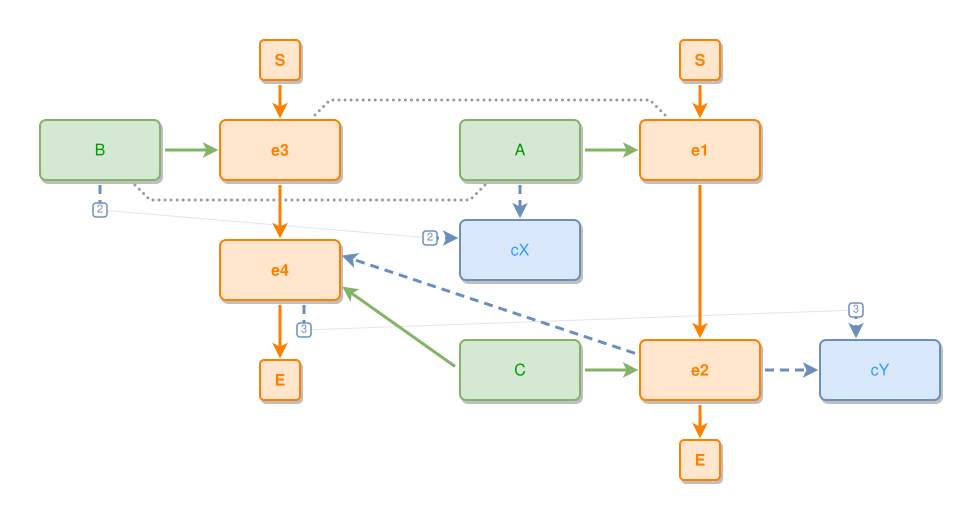

<!-- AUTO-GENERATED FILE - DO NOT EDIT -->
<!-- Generated by: gen-test-md -->
<!-- Command: go run ./cmd-dev/gen-test-md -->

# cross-component-arrivals-keep-the-approach-order

> **⚠️ Warning:** This file is auto-generated. Manual changes will be lost when tests are regenerated.

**Source:** gl:docs/dev/layout-gen/layout-alg-ext.md#L798-L808 | [docs/dev/layout-gen/layout-alg-ext.md](../../docs/dev/layout-gen/layout-alg-ext.md#cross-component-arrivals-keep-the-approach-order)

## ipmt Content

```ipmt
e1 --> e2
A ::t --> e1
e3 --> e4
B ::t --> e3
A ::t --- B ::t
e2 --::X--> e4
e1 --- e3
A ::t, B ::t --> cX ::c
e2, e4 --> cY ::c
C ::t --> e2, e4
```

## Generated Files

- [cross-component-arrivals-keep-the-approach-order.ipmt](cross-component-arrivals-keep-the-approach-order.ipmt) - ipmt input
- [cross-component-arrivals-keep-the-approach-order.json](cross-component-arrivals-keep-the-approach-order.json) - Parsed structure
- [cross-component-arrivals-keep-the-approach-order.layout.json](cross-component-arrivals-keep-the-approach-order.layout.json) - Layout coordinates
- [cross-component-arrivals-keep-the-approach-order.ipm.svg](cross-component-arrivals-keep-the-approach-order.ipm.svg) - Rendered diagram

## Rendered Diagram



This test case was automatically generated from the specification document.

The ipmt code block was extracted using [sync-test-cases](../../docs/dev/testing.md) and saved to [cross-component-arrivals-keep-the-approach-order.ipmt](cross-component-arrivals-keep-the-approach-order.ipmt), then parsed into the [JSON structure](cross-component-arrivals-keep-the-approach-order.json) and laid out into [layout coordinates](cross-component-arrivals-keep-the-approach-order.layout.json). The [SVG diagram](cross-component-arrivals-keep-the-approach-order.ipm.svg) was rendered using [ipmsvg-gen](../../docs/ipmsvg-gen.md).
