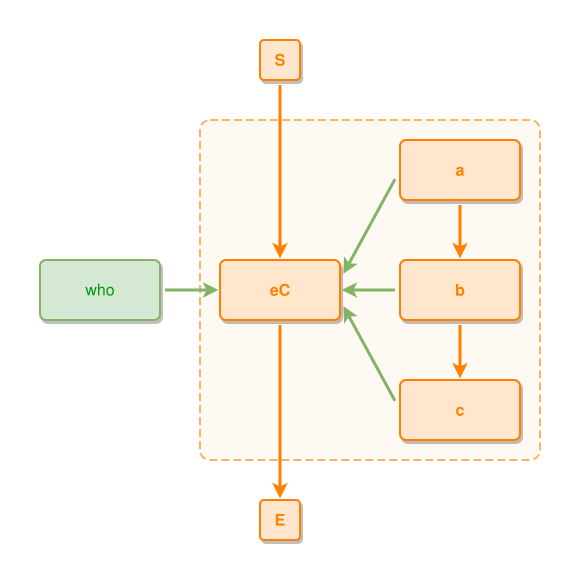

<!-- AUTO-GENERATED FILE - DO NOT EDIT -->
<!-- Generated by: gen-test-md -->
<!-- Command: go run ./cmd-dev/gen-test-md -->

# a-covering-thing-stays-outside-the-shell-and-connects-to-the-composite-itself

> **⚠️ Warning:** This file is auto-generated. Manual changes will be lost when tests are regenerated.

**Source:** gl:docs/dev/layout-gen/layout-alg-shells.md#L175-L179 | [docs/dev/layout-gen/layout-alg-shells.md](../../docs/dev/layout-gen/layout-alg-shells.md#a-covering-thing-stays-outside-the-shell-and-connects-to-the-composite-itself)

## ipmt Content

```ipmt
# ipmt: embed=false
a ::e --> b ::e --> c ::e
a, b, c --::P--> eC ::e
who ::t --::P--> eC
```

## Generated Files

- [a-covering-thing-stays-outside-the-shell-and-connects-to-the-composite-itself.ipmt](a-covering-thing-stays-outside-the-shell-and-connects-to-the-composite-itself.ipmt) - ipmt input
- [a-covering-thing-stays-outside-the-shell-and-connects-to-the-composite-itself.json](a-covering-thing-stays-outside-the-shell-and-connects-to-the-composite-itself.json) - Parsed structure
- [a-covering-thing-stays-outside-the-shell-and-connects-to-the-composite-itself.layout.json](a-covering-thing-stays-outside-the-shell-and-connects-to-the-composite-itself.layout.json) - Layout coordinates
- [a-covering-thing-stays-outside-the-shell-and-connects-to-the-composite-itself.ipm.svg](a-covering-thing-stays-outside-the-shell-and-connects-to-the-composite-itself.ipm.svg) - Rendered diagram

## Rendered Diagram



This test case was automatically generated from the specification document.

The ipmt code block was extracted using [sync-test-cases](../../docs/dev/testing.md) and saved to [a-covering-thing-stays-outside-the-shell-and-connects-to-the-composite-itself.ipmt](a-covering-thing-stays-outside-the-shell-and-connects-to-the-composite-itself.ipmt), then parsed into the [JSON structure](a-covering-thing-stays-outside-the-shell-and-connects-to-the-composite-itself.json) and laid out into [layout coordinates](a-covering-thing-stays-outside-the-shell-and-connects-to-the-composite-itself.layout.json). The [SVG diagram](a-covering-thing-stays-outside-the-shell-and-connects-to-the-composite-itself.ipm.svg) was rendered using [ipmsvg-gen](../../docs/ipmsvg-gen.md).
