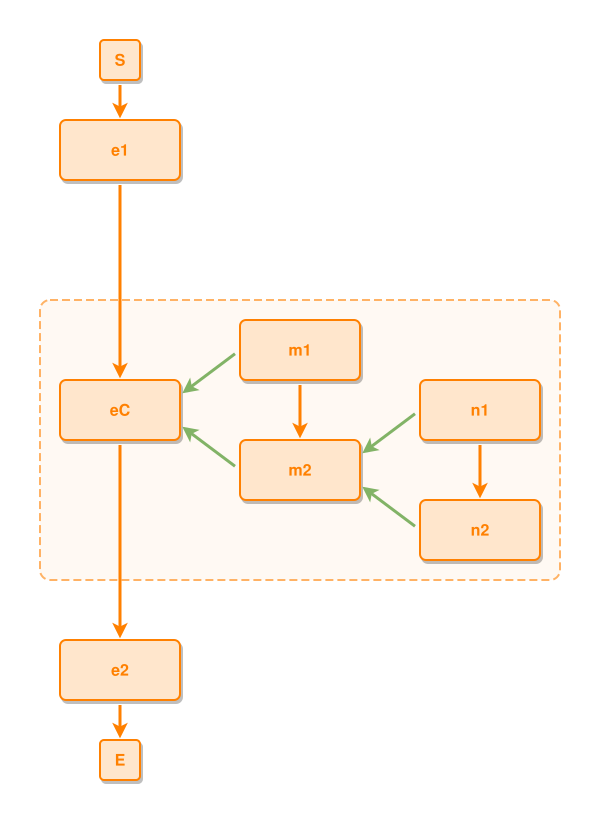

<!-- AUTO-GENERATED FILE - DO NOT EDIT -->
<!-- Generated by: gen-test-md -->
<!-- Command: go run ./cmd-dev/gen-test-md -->

# a-nested-composite-shares-its-roots-shell

> **⚠️ Warning:** This file is auto-generated. Manual changes will be lost when tests are regenerated.

**Source:** gl:docs/dev/layout-gen/layout-alg-shells.md#L211-L217 | [docs/dev/layout-gen/layout-alg-shells.md](../../docs/dev/layout-gen/layout-alg-shells.md#a-nested-composite-shares-its-roots-shell)

## ipmt Content

```ipmt
# ipmt: embed=false
e1 ::e --> eC ::e --> e2 ::e
m1 ::e --> m2 ::e
m1, m2 --::P--> eC
n1 ::e --> n2 ::e
n1, n2 --::P--> m2
```

## Generated Files

- [a-nested-composite-shares-its-roots-shell.ipmt](a-nested-composite-shares-its-roots-shell.ipmt) - ipmt input
- [a-nested-composite-shares-its-roots-shell.json](a-nested-composite-shares-its-roots-shell.json) - Parsed structure
- [a-nested-composite-shares-its-roots-shell.layout.json](a-nested-composite-shares-its-roots-shell.layout.json) - Layout coordinates
- [a-nested-composite-shares-its-roots-shell.ipm.svg](a-nested-composite-shares-its-roots-shell.ipm.svg) - Rendered diagram

## Rendered Diagram



This test case was automatically generated from the specification document.

The ipmt code block was extracted using [sync-test-cases](../../docs/dev/testing.md) and saved to [a-nested-composite-shares-its-roots-shell.ipmt](a-nested-composite-shares-its-roots-shell.ipmt), then parsed into the [JSON structure](a-nested-composite-shares-its-roots-shell.json) and laid out into [layout coordinates](a-nested-composite-shares-its-roots-shell.layout.json). The [SVG diagram](a-nested-composite-shares-its-roots-shell.ipm.svg) was rendered using [ipmsvg-gen](../../docs/ipmsvg-gen.md).
