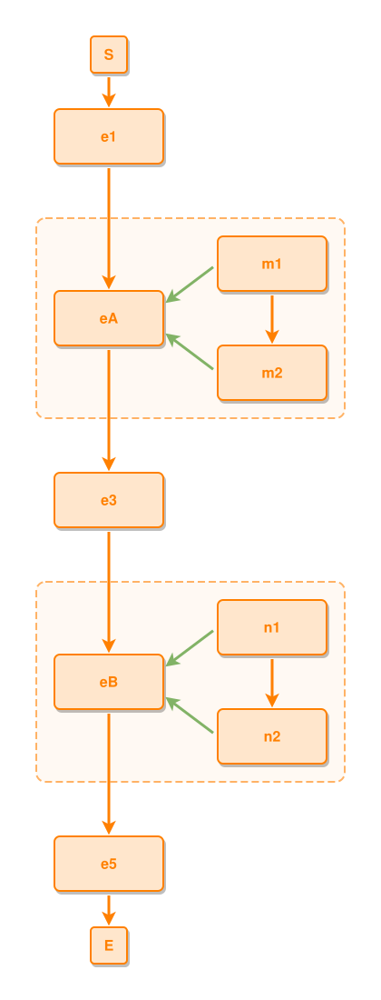

<!-- AUTO-GENERATED FILE - DO NOT EDIT -->
<!-- Generated by: gen-test-md -->
<!-- Command: go run ./cmd-dev/gen-test-md -->

# two-root-composites-get-one-shell-each-and-the-spine-threads-between-them

> **⚠️ Warning:** This file is auto-generated. Manual changes will be lost when tests are regenerated.

**Source:** gl:docs/dev/layout-gen/layout-alg-shells.md#L241-L247 | [docs/dev/layout-gen/layout-alg-shells.md](../../docs/dev/layout-gen/layout-alg-shells.md#two-root-composites-get-one-shell-each-and-the-spine-threads-between-them)

## ipmt Content

```ipmt
# ipmt: embed=false
e1 ::e --> eA ::e --> e3 ::e --> eB ::e --> e5 ::e
m1 ::e --> m2 ::e
m1, m2 --::P--> eA
n1 ::e --> n2 ::e
n1, n2 --::P--> eB
```

## Generated Files

- [two-root-composites-get-one-shell-each-and-the-spine-threads-between-them.ipmt](two-root-composites-get-one-shell-each-and-the-spine-threads-between-them.ipmt) - ipmt input
- [two-root-composites-get-one-shell-each-and-the-spine-threads-between-them.json](two-root-composites-get-one-shell-each-and-the-spine-threads-between-them.json) - Parsed structure
- [two-root-composites-get-one-shell-each-and-the-spine-threads-between-them.layout.json](two-root-composites-get-one-shell-each-and-the-spine-threads-between-them.layout.json) - Layout coordinates
- [two-root-composites-get-one-shell-each-and-the-spine-threads-between-them.ipm.svg](two-root-composites-get-one-shell-each-and-the-spine-threads-between-them.ipm.svg) - Rendered diagram

## Rendered Diagram



This test case was automatically generated from the specification document.

The ipmt code block was extracted using [sync-test-cases](../../docs/dev/testing.md) and saved to [two-root-composites-get-one-shell-each-and-the-spine-threads-between-them.ipmt](two-root-composites-get-one-shell-each-and-the-spine-threads-between-them.ipmt), then parsed into the [JSON structure](two-root-composites-get-one-shell-each-and-the-spine-threads-between-them.json) and laid out into [layout coordinates](two-root-composites-get-one-shell-each-and-the-spine-threads-between-them.layout.json). The [SVG diagram](two-root-composites-get-one-shell-each-and-the-spine-threads-between-them.ipm.svg) was rendered using [ipmsvg-gen](../../docs/ipmsvg-gen.md).
