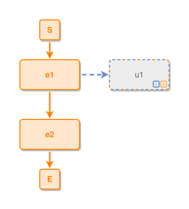

<!-- AUTO-GENERATED FILE - DO NOT EDIT -->
<!-- Generated by: gen-test-md -->
<!-- Command: go run ./cmd-dev/gen-test-md -->

# a-concept-primary-undecided-node-lands-on-the-concepts-flank

> **⚠️ Warning:** This file is auto-generated. Manual changes will be lost when tests are regenerated.

**Source:** gl:docs/dev/layout-gen/layout-alg.md#L3059-L3061 | [docs/dev/layout-gen/layout-alg.md](../../docs/dev/layout-gen/layout-alg.md#a-concept-primary-undecided-node-lands-on-the-concepts-flank)

## ipmt Content

```ipmt
e1 --> e2
e1 --> u1 ::?ce
```

## Generated Files

- [a-concept-primary-undecided-node-lands-on-the-concepts-flank.ipmt](a-concept-primary-undecided-node-lands-on-the-concepts-flank.ipmt) - ipmt input
- [a-concept-primary-undecided-node-lands-on-the-concepts-flank.json](a-concept-primary-undecided-node-lands-on-the-concepts-flank.json) - Parsed structure
- [a-concept-primary-undecided-node-lands-on-the-concepts-flank.layout.json](a-concept-primary-undecided-node-lands-on-the-concepts-flank.layout.json) - Layout coordinates
- [a-concept-primary-undecided-node-lands-on-the-concepts-flank.ipm.svg](a-concept-primary-undecided-node-lands-on-the-concepts-flank.ipm.svg) - Rendered diagram

## Layout Validation Rules

Test line: 3059

✅ All 5 rules passed

- ✓ [Line 53](gl:docs/dev/layout-gen/layout-alg.md#L53): `each edge has max-bends=0` ([edges-run-straight-by-default.dsl](../layout-gen-rules/edges-run-straight-by-default.dsl))
- ✓ [Line 3070](gl:docs/dev/layout-gen/layout-alg.md#L3070): `type=unresolved has size=120x60` ([a-concept-primary-undecided-node-lands-on-the-concepts-flank.dsl](../layout-gen-rules/a-concept-primary-undecided-node-lands-on-the-concepts-flank.dsl))
- ✓ [Line 3071](gl:docs/dev/layout-gen/layout-alg.md#L3071): `#u1 is right-of #e1 with gap=60` ([a-concept-primary-undecided-node-lands-on-the-concepts-flank-02.dsl](../layout-gen-rules/a-concept-primary-undecided-node-lands-on-the-concepts-flank-02.dsl))
- ✓ [Line 3072](gl:docs/dev/layout-gen/layout-alg.md#L3072): `#e1,#u1 have same y` ([a-concept-primary-undecided-node-lands-on-the-concepts-flank-03.dsl](../layout-gen-rules/a-concept-primary-undecided-node-lands-on-the-concepts-flank-03.dsl))
- ✓ [Line 3073](gl:docs/dev/layout-gen/layout-alg.md#L3073): `edge #e1,#u1 has type=expresses` ([a-concept-primary-undecided-node-lands-on-the-concepts-flank-04.dsl](../layout-gen-rules/a-concept-primary-undecided-node-lands-on-the-concepts-flank-04.dsl))

## Rendered Diagram



This test case was automatically generated from the specification document.

The ipmt code block was extracted using [sync-test-cases](../../docs/dev/testing.md) and saved to [a-concept-primary-undecided-node-lands-on-the-concepts-flank.ipmt](a-concept-primary-undecided-node-lands-on-the-concepts-flank.ipmt), then parsed into the [JSON structure](a-concept-primary-undecided-node-lands-on-the-concepts-flank.json) and laid out into [layout coordinates](a-concept-primary-undecided-node-lands-on-the-concepts-flank.layout.json). The [SVG diagram](a-concept-primary-undecided-node-lands-on-the-concepts-flank.ipm.svg) was rendered using [ipmsvg-gen](../../docs/ipmsvg-gen.md).
