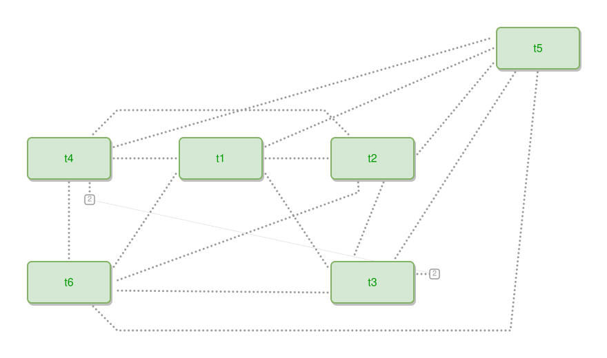

<!-- AUTO-GENERATED FILE - DO NOT EDIT -->
<!-- Generated by: gen-test-md -->
<!-- Command: go run ./cmd-dev/gen-test-md -->

# a-denser-clique-hides-the-tie-neither-end-needs

> **⚠️ Warning:** This file is auto-generated. Manual changes will be lost when tests are regenerated.

**Source:** gl:docs/dev/layout-gen/layout-alg.md#L3452-L3467 | [docs/dev/layout-gen/layout-alg.md](../../docs/dev/layout-gen/layout-alg.md#a-denser-clique-hides-the-tie-neither-end-needs)

## ipmt Content

```ipmt
t1 ::t --- t2 ::t
t1 ::t --- t3 ::t
t1 ::t --- t4 ::t
t1 ::t --- t5 ::t
t1 ::t --- t6 ::t
t2 ::t --- t3 ::t
t2 ::t --- t4 ::t
t2 ::t --- t5 ::t
t2 ::t --- t6 ::t
t3 ::t --- t4 ::t
t3 ::t --- t5 ::t
t3 ::t --- t6 ::t
t4 ::t --- t5 ::t
t4 ::t --- t6 ::t
t5 ::t --- t6 ::t
```

## Generated Files

- [a-denser-clique-hides-the-tie-neither-end-needs.ipmt](a-denser-clique-hides-the-tie-neither-end-needs.ipmt) - ipmt input
- [a-denser-clique-hides-the-tie-neither-end-needs.json](a-denser-clique-hides-the-tie-neither-end-needs.json) - Parsed structure
- [a-denser-clique-hides-the-tie-neither-end-needs.layout.json](a-denser-clique-hides-the-tie-neither-end-needs.layout.json) - Layout coordinates
- [a-denser-clique-hides-the-tie-neither-end-needs.ipm.svg](a-denser-clique-hides-the-tie-neither-end-needs.ipm.svg) - Rendered diagram

## Layout Validation Rules

Test line: 3452

⚠️ 10/11 rules passed

- ✗ [Line 53](gl:docs/dev/layout-gen/layout-alg.md#L53): `each edge has max-bends=0` - **edge t2->t4 has 2 bends > max-bends 0 (each-edge default; if the detour is intended, add it to `except` and pin it with `edge #t2,#t4 has max-bends=2`)** ([edges-run-straight-by-default.dsl](../layout-gen-rules/edges-run-straight-by-default.dsl))
- ✓ [Line 3480](gl:docs/dev/layout-gen/layout-alg.md#L3480): `each edge has max-bends=0 except #t2,#t4 #t2,#t6 #t5,#t6` ([a-denser-clique-hides-the-tie-neither-end-needs.dsl](../layout-gen-rules/a-denser-clique-hides-the-tie-neither-end-needs.dsl))
- ✓ [Line 3481](gl:docs/dev/layout-gen/layout-alg.md#L3481): `edge #t3,#t4 has visibility=stubbed` ([a-denser-clique-hides-the-tie-neither-end-needs-02.dsl](../layout-gen-rules/a-denser-clique-hides-the-tie-neither-end-needs-02.dsl))
- ✓ [Line 3482](gl:docs/dev/layout-gen/layout-alg.md#L3482): `edge #t3,#t5 has visibility=visible` ([a-denser-clique-hides-the-tie-neither-end-needs-03.dsl](../layout-gen-rules/a-denser-clique-hides-the-tie-neither-end-needs-03.dsl))
- ✓ [Line 3483](gl:docs/dev/layout-gen/layout-alg.md#L3483): `edge #t3,#t6 has visibility=visible` ([a-denser-clique-hides-the-tie-neither-end-needs-04.dsl](../layout-gen-rules/a-denser-clique-hides-the-tie-neither-end-needs-04.dsl))
- ✓ [Line 3484](gl:docs/dev/layout-gen/layout-alg.md#L3484): `edge #t1,#t4 has visibility=visible` ([a-denser-clique-hides-the-tie-neither-end-needs-05.dsl](../layout-gen-rules/a-denser-clique-hides-the-tie-neither-end-needs-05.dsl))
- ✓ [Line 3485](gl:docs/dev/layout-gen/layout-alg.md#L3485): `edge #t4,#t5 has visibility=visible` ([a-denser-clique-hides-the-tie-neither-end-needs-06.dsl](../layout-gen-rules/a-denser-clique-hides-the-tie-neither-end-needs-06.dsl))
- ✓ [Line 3486](gl:docs/dev/layout-gen/layout-alg.md#L3486): `edge #t4,#t6 has visibility=visible` ([a-denser-clique-hides-the-tie-neither-end-needs-07.dsl](../layout-gen-rules/a-denser-clique-hides-the-tie-neither-end-needs-07.dsl))
- ✓ [Line 3487](gl:docs/dev/layout-gen/layout-alg.md#L3487): `edge #t2,#t4 has max-bends=2` ([a-denser-clique-hides-the-tie-neither-end-needs-08.dsl](../layout-gen-rules/a-denser-clique-hides-the-tie-neither-end-needs-08.dsl))
- ✓ [Line 3488](gl:docs/dev/layout-gen/layout-alg.md#L3488): `edge #t2,#t6 has max-bends=1` ([a-denser-clique-hides-the-tie-neither-end-needs-09.dsl](../layout-gen-rules/a-denser-clique-hides-the-tie-neither-end-needs-09.dsl))
- ✓ [Line 3489](gl:docs/dev/layout-gen/layout-alg.md#L3489): `edge #t5,#t6 has max-bends=2` ([a-denser-clique-hides-the-tie-neither-end-needs-10.dsl](../layout-gen-rules/a-denser-clique-hides-the-tie-neither-end-needs-10.dsl))

## Rendered Diagram



This test case was automatically generated from the specification document.

The ipmt code block was extracted using [sync-test-cases](../../docs/dev/testing.md) and saved to [a-denser-clique-hides-the-tie-neither-end-needs.ipmt](a-denser-clique-hides-the-tie-neither-end-needs.ipmt), then parsed into the [JSON structure](a-denser-clique-hides-the-tie-neither-end-needs.json) and laid out into [layout coordinates](a-denser-clique-hides-the-tie-neither-end-needs.layout.json). The [SVG diagram](a-denser-clique-hides-the-tie-neither-end-needs.ipm.svg) was rendered using [ipmsvg-gen](../../docs/ipmsvg-gen.md).
