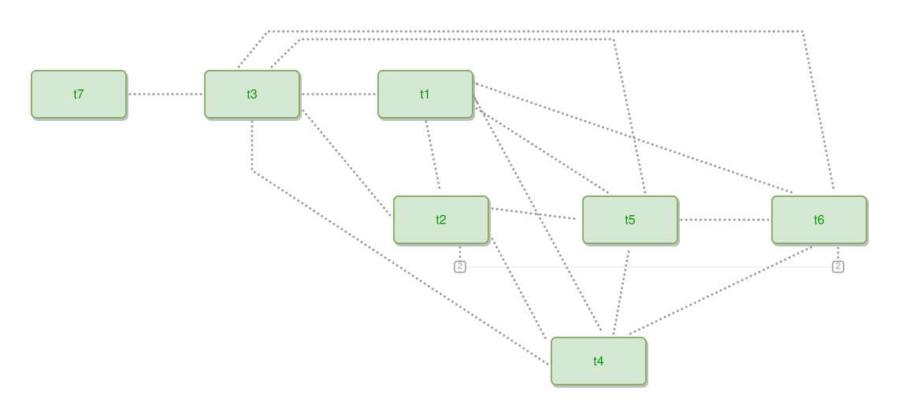

<!-- AUTO-GENERATED FILE - DO NOT EDIT -->
<!-- Generated by: gen-test-md -->
<!-- Command: go run ./cmd-dev/gen-test-md -->

# a-lone-tie-is-never-the-one-that-hides

> **⚠️ Warning:** This file is auto-generated. Manual changes will be lost when tests are regenerated.

**Source:** gl:docs/dev/layout-gen/layout-alg.md#L3501-L3517 | [docs/dev/layout-gen/layout-alg.md](../../docs/dev/layout-gen/layout-alg.md#a-lone-tie-is-never-the-one-that-hides)

## ipmt Content

```ipmt
t1 ::t --- t2 ::t
t1 ::t --- t3 ::t
t1 ::t --- t4 ::t
t1 ::t --- t5 ::t
t1 ::t --- t6 ::t
t2 ::t --- t3 ::t
t2 ::t --- t4 ::t
t2 ::t --- t5 ::t
t2 ::t --- t6 ::t
t3 ::t --- t4 ::t
t3 ::t --- t5 ::t
t3 ::t --- t6 ::t
t4 ::t --- t5 ::t
t4 ::t --- t6 ::t
t5 ::t --- t6 ::t
t7 ::t --- t3 ::t
```

## Generated Files

- [a-lone-tie-is-never-the-one-that-hides.ipmt](a-lone-tie-is-never-the-one-that-hides.ipmt) - ipmt input
- [a-lone-tie-is-never-the-one-that-hides.json](a-lone-tie-is-never-the-one-that-hides.json) - Parsed structure
- [a-lone-tie-is-never-the-one-that-hides.layout.json](a-lone-tie-is-never-the-one-that-hides.layout.json) - Layout coordinates
- [a-lone-tie-is-never-the-one-that-hides.ipm.svg](a-lone-tie-is-never-the-one-that-hides.ipm.svg) - Rendered diagram

## Layout Validation Rules

Test line: 3501

⚠️ 11/12 rules passed

- ✗ [Line 53](gl:docs/dev/layout-gen/layout-alg.md#L53): `each edge has max-bends=0` - **edge t1->t4 has 1 bends > max-bends 0 (each-edge default; if the detour is intended, add it to `except` and pin it with `edge #t1,#t4 has max-bends=1`)** ([edges-run-straight-by-default.dsl](../layout-gen-rules/edges-run-straight-by-default.dsl))
- ✓ [Line 3529](gl:docs/dev/layout-gen/layout-alg.md#L3529): `each edge has max-bends=0 except #t1,#t4 #t1,#t5 #t1,#t6 #t3,#t4 #t3,#t5 #t3,#t6` ([a-lone-tie-is-never-the-one-that-hides.dsl](../layout-gen-rules/a-lone-tie-is-never-the-one-that-hides.dsl))
- ✓ [Line 3530](gl:docs/dev/layout-gen/layout-alg.md#L3530): `edge #t7,#t3 has visibility=visible` ([a-lone-tie-is-never-the-one-that-hides-02.dsl](../layout-gen-rules/a-lone-tie-is-never-the-one-that-hides-02.dsl))
- ✓ [Line 3531](gl:docs/dev/layout-gen/layout-alg.md#L3531): `edge #t2,#t6 has visibility=stubbed` ([a-lone-tie-is-never-the-one-that-hides-03.dsl](../layout-gen-rules/a-lone-tie-is-never-the-one-that-hides-03.dsl))
- ✓ [Line 3532](gl:docs/dev/layout-gen/layout-alg.md#L3532): `#t7 has x=40` ([a-lone-tie-is-never-the-one-that-hides-04.dsl](../layout-gen-rules/a-lone-tie-is-never-the-one-that-hides-04.dsl))
- ✓ [Line 3533](gl:docs/dev/layout-gen/layout-alg.md#L3533): `#t7,#t3 have same y` ([a-lone-tie-is-never-the-one-that-hides-05.dsl](../layout-gen-rules/a-lone-tie-is-never-the-one-that-hides-05.dsl))
- ✓ [Line 3534](gl:docs/dev/layout-gen/layout-alg.md#L3534): `edge #t1,#t4 has max-bends=1` ([a-lone-tie-is-never-the-one-that-hides-06.dsl](../layout-gen-rules/a-lone-tie-is-never-the-one-that-hides-06.dsl))
- ✓ [Line 3535](gl:docs/dev/layout-gen/layout-alg.md#L3535): `edge #t1,#t5 has max-bends=1` ([a-lone-tie-is-never-the-one-that-hides-07.dsl](../layout-gen-rules/a-lone-tie-is-never-the-one-that-hides-07.dsl))
- ✓ [Line 3536](gl:docs/dev/layout-gen/layout-alg.md#L3536): `edge #t1,#t6 has max-bends=1` ([a-lone-tie-is-never-the-one-that-hides-08.dsl](../layout-gen-rules/a-lone-tie-is-never-the-one-that-hides-08.dsl))
- ✓ [Line 3537](gl:docs/dev/layout-gen/layout-alg.md#L3537): `edge #t3,#t4 has max-bends=1` ([a-lone-tie-is-never-the-one-that-hides-09.dsl](../layout-gen-rules/a-lone-tie-is-never-the-one-that-hides-09.dsl))
- ✓ [Line 3538](gl:docs/dev/layout-gen/layout-alg.md#L3538): `edge #t3,#t5 has max-bends=2` ([a-lone-tie-is-never-the-one-that-hides-10.dsl](../layout-gen-rules/a-lone-tie-is-never-the-one-that-hides-10.dsl))
- ✓ [Line 3539](gl:docs/dev/layout-gen/layout-alg.md#L3539): `edge #t3,#t6 has max-bends=2` ([a-lone-tie-is-never-the-one-that-hides-11.dsl](../layout-gen-rules/a-lone-tie-is-never-the-one-that-hides-11.dsl))

## Rendered Diagram



This test case was automatically generated from the specification document.

The ipmt code block was extracted using [sync-test-cases](../../docs/dev/testing.md) and saved to [a-lone-tie-is-never-the-one-that-hides.ipmt](a-lone-tie-is-never-the-one-that-hides.ipmt), then parsed into the [JSON structure](a-lone-tie-is-never-the-one-that-hides.json) and laid out into [layout coordinates](a-lone-tie-is-never-the-one-that-hides.layout.json). The [SVG diagram](a-lone-tie-is-never-the-one-that-hides.ipm.svg) was rendered using [ipmsvg-gen](../../docs/ipmsvg-gen.md).
