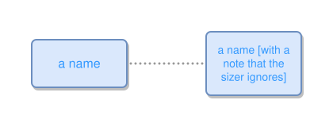

<!-- AUTO-GENERATED FILE - DO NOT EDIT -->
<!-- Generated by: gen-test-md -->
<!-- Command: go run ./cmd-dev/gen-test-md -->

# a-quoted-name-keeps-its-brackets-and-pays-for-them

> **⚠️ Warning:** This file is auto-generated. Manual changes will be lost when tests are regenerated.

**Source:** gl:docs/dev/layout-gen/layout-alg.md#L175-L176 | [docs/dev/layout-gen/layout-alg.md](../../docs/dev/layout-gen/layout-alg.md#a-quoted-name-keeps-its-brackets-and-pays-for-them)

## ipmt Content

```ipmt
p1::a a name [with a note that the sizer ignores] ::c --- p2::a "a name [with a note that the sizer ignores]" ::c
```

## Generated Files

- [a-quoted-name-keeps-its-brackets-and-pays-for-them.ipmt](a-quoted-name-keeps-its-brackets-and-pays-for-them.ipmt) - ipmt input
- [a-quoted-name-keeps-its-brackets-and-pays-for-them.json](a-quoted-name-keeps-its-brackets-and-pays-for-them.json) - Parsed structure
- [a-quoted-name-keeps-its-brackets-and-pays-for-them.layout.json](a-quoted-name-keeps-its-brackets-and-pays-for-them.layout.json) - Layout coordinates
- [a-quoted-name-keeps-its-brackets-and-pays-for-them.ipm.svg](a-quoted-name-keeps-its-brackets-and-pays-for-them.ipm.svg) - Rendered diagram

## Layout Validation Rules

Test line: 175

✅ All 6 rules passed

- ✓ [Line 53](gl:docs/dev/layout-gen/layout-alg.md#L53): `each edge has max-bends=0` ([edges-run-straight-by-default.dsl](../layout-gen-rules/edges-run-straight-by-default.dsl))
- ✓ [Line 82](gl:docs/dev/layout-gen/layout-alg.md#L82): `type=event has width=120` ([one-event.dsl](../layout-gen-rules/one-event.dsl))
- ✓ [Line 83](gl:docs/dev/layout-gen/layout-alg.md#L83): `type=event has min-gap-to-others>=10` ([one-event-02.dsl](../layout-gen-rules/one-event-02.dsl))
- ✓ [Line 84](gl:docs/dev/layout-gen/layout-alg.md#L84): `type=boundary has size=40x40` ([one-event-03.dsl](../layout-gen-rules/one-event-03.dsl))
- ✓ [Line 185](gl:docs/dev/layout-gen/layout-alg.md#L185): `#p1 has height=60` ([a-quoted-name-keeps-its-brackets-and-pays-for-them.dsl](../layout-gen-rules/a-quoted-name-keeps-its-brackets-and-pays-for-them.dsl))
- ✓ [Line 186](gl:docs/dev/layout-gen/layout-alg.md#L186): `#p2 has height=80` ([a-quoted-name-keeps-its-brackets-and-pays-for-them-02.dsl](../layout-gen-rules/a-quoted-name-keeps-its-brackets-and-pays-for-them-02.dsl))

## Rendered Diagram



This test case was automatically generated from the specification document.

The ipmt code block was extracted using [sync-test-cases](../../docs/dev/testing.md) and saved to [a-quoted-name-keeps-its-brackets-and-pays-for-them.ipmt](a-quoted-name-keeps-its-brackets-and-pays-for-them.ipmt), then parsed into the [JSON structure](a-quoted-name-keeps-its-brackets-and-pays-for-them.json) and laid out into [layout coordinates](a-quoted-name-keeps-its-brackets-and-pays-for-them.layout.json). The [SVG diagram](a-quoted-name-keeps-its-brackets-and-pays-for-them.ipm.svg) was rendered using [ipmsvg-gen](../../docs/ipmsvg-gen.md).
