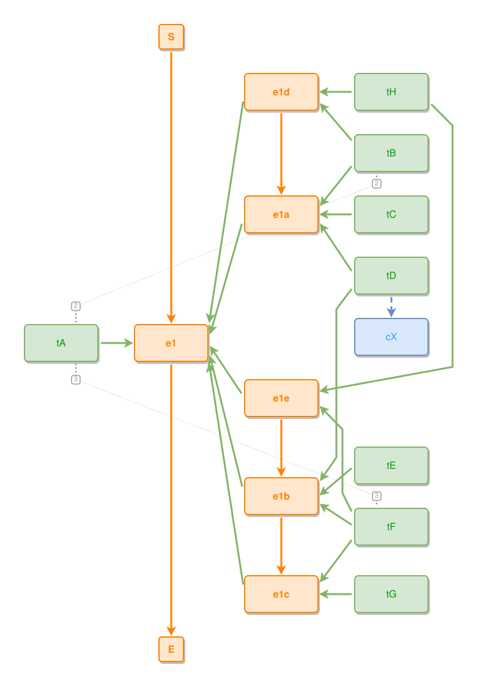

<!-- AUTO-GENERATED FILE - DO NOT EDIT -->
<!-- Generated by: gen-test-md -->
<!-- Command: go run ./cmd-dev/gen-test-md -->

# a-stranded-leaf-concept-comes-back-to-its-owner

> **⚠️ Warning:** This file is auto-generated. Manual changes will be lost when tests are regenerated.

**Source:** gl:docs/dev/layout-gen/layout-alg.md#L2658-L2675 | [docs/dev/layout-gen/layout-alg.md](../../docs/dev/layout-gen/layout-alg.md#a-stranded-leaf-concept-comes-back-to-its-owner)

## ipmt Content

```ipmt
e1 ::e
tA --> e1
tB, tC, tD --> e1a ::e --::P--> e1
tA --- tB

e1b ::e --::P--> e1
tE, tF --> e1b
tD --> e1b
tD --> cX ::c
e1c ::e --::P--> e1
tG, tF --> e1c
tA --- tF

tH, tB --> e1d ::e --::P--> e1
e1d --> e1a
tH, tF --> e1e ::e --::P--> e1
e1e --> e1b --> e1c
```

## Generated Files

- [a-stranded-leaf-concept-comes-back-to-its-owner.ipmt](a-stranded-leaf-concept-comes-back-to-its-owner.ipmt) - ipmt input
- [a-stranded-leaf-concept-comes-back-to-its-owner.json](a-stranded-leaf-concept-comes-back-to-its-owner.json) - Parsed structure
- [a-stranded-leaf-concept-comes-back-to-its-owner.layout.json](a-stranded-leaf-concept-comes-back-to-its-owner.layout.json) - Layout coordinates
- [a-stranded-leaf-concept-comes-back-to-its-owner.ipm.svg](a-stranded-leaf-concept-comes-back-to-its-owner.ipm.svg) - Rendered diagram

## Layout Validation Rules

Test line: 2658

✅ All 15 rules passed

- ✓ [Line 53](gl:docs/dev/layout-gen/layout-alg.md#L53): `each edge has max-bends=0` ([edges-run-straight-by-default.dsl](../layout-gen-rules/edges-run-straight-by-default.dsl))
- ✓ [Line 2696](gl:docs/dev/layout-gen/layout-alg.md#L2696): `each edge has max-bends=0 except #tA,#tB #tD,#e1b #tH,#e1e #tF,#e1e` ([a-stranded-leaf-concept-comes-back-to-its-owner.dsl](../layout-gen-rules/a-stranded-leaf-concept-comes-back-to-its-owner.dsl))
- ✓ [Line 2697](gl:docs/dev/layout-gen/layout-alg.md#L2697): `edge #tA,#tB has max-bends=2` ([a-stranded-leaf-concept-comes-back-to-its-owner-02.dsl](../layout-gen-rules/a-stranded-leaf-concept-comes-back-to-its-owner-02.dsl))
- ✓ [Line 2698](gl:docs/dev/layout-gen/layout-alg.md#L2698): `edge #tD,#e1b has max-bends=2` ([a-stranded-leaf-concept-comes-back-to-its-owner-03.dsl](../layout-gen-rules/a-stranded-leaf-concept-comes-back-to-its-owner-03.dsl))
- ✓ [Line 2699](gl:docs/dev/layout-gen/layout-alg.md#L2699): `edge #tH,#e1e has max-bends=2` ([a-stranded-leaf-concept-comes-back-to-its-owner-04.dsl](../layout-gen-rules/a-stranded-leaf-concept-comes-back-to-its-owner-04.dsl))
- ✓ [Line 2700](gl:docs/dev/layout-gen/layout-alg.md#L2700): `edge #tF,#e1e has max-bends=2` ([a-stranded-leaf-concept-comes-back-to-its-owner-05.dsl](../layout-gen-rules/a-stranded-leaf-concept-comes-back-to-its-owner-05.dsl))
- ✓ [Line 2701](gl:docs/dev/layout-gen/layout-alg.md#L2701): `edge #tD,#cX has max-bends=0` ([a-stranded-leaf-concept-comes-back-to-its-owner-06.dsl](../layout-gen-rules/a-stranded-leaf-concept-comes-back-to-its-owner-06.dsl))
- ✓ [Line 2702](gl:docs/dev/layout-gen/layout-alg.md#L2702): `edge #tD,#cX has visibility=visible` ([a-stranded-leaf-concept-comes-back-to-its-owner-07.dsl](../layout-gen-rules/a-stranded-leaf-concept-comes-back-to-its-owner-07.dsl))
- ✓ [Line 2703](gl:docs/dev/layout-gen/layout-alg.md#L2703): `edge #tD,#cX has source-side=bottom` ([a-stranded-leaf-concept-comes-back-to-its-owner-08.dsl](../layout-gen-rules/a-stranded-leaf-concept-comes-back-to-its-owner-08.dsl))
- ✓ [Line 2704](gl:docs/dev/layout-gen/layout-alg.md#L2704): `edge #tD,#cX has target-side=top` ([a-stranded-leaf-concept-comes-back-to-its-owner-09.dsl](../layout-gen-rules/a-stranded-leaf-concept-comes-back-to-its-owner-09.dsl))
- ✓ [Line 2705](gl:docs/dev/layout-gen/layout-alg.md#L2705): `#tD,#cX have same center-x` ([a-stranded-leaf-concept-comes-back-to-its-owner-10.dsl](../layout-gen-rules/a-stranded-leaf-concept-comes-back-to-its-owner-10.dsl))
- ✓ [Line 2706](gl:docs/dev/layout-gen/layout-alg.md#L2706): `#cX is below #tD with gap=40` ([a-stranded-leaf-concept-comes-back-to-its-owner-11.dsl](../layout-gen-rules/a-stranded-leaf-concept-comes-back-to-its-owner-11.dsl))
- ✓ [Line 2707](gl:docs/dev/layout-gen/layout-alg.md#L2707): `#tB is below #tH with gap=40` ([a-stranded-leaf-concept-comes-back-to-its-owner-12.dsl](../layout-gen-rules/a-stranded-leaf-concept-comes-back-to-its-owner-12.dsl))
- ✓ [Line 2708](gl:docs/dev/layout-gen/layout-alg.md#L2708): `edge #tH,#e1d has max-bends=0` ([a-stranded-leaf-concept-comes-back-to-its-owner-13.dsl](../layout-gen-rules/a-stranded-leaf-concept-comes-back-to-its-owner-13.dsl))
- ✓ [Line 2709](gl:docs/dev/layout-gen/layout-alg.md#L2709): `#tH is right-of #e1d with gap=60` ([a-stranded-leaf-concept-comes-back-to-its-owner-14.dsl](../layout-gen-rules/a-stranded-leaf-concept-comes-back-to-its-owner-14.dsl))

## Rendered Diagram



This test case was automatically generated from the specification document.

The ipmt code block was extracted using [sync-test-cases](../../docs/dev/testing.md) and saved to [a-stranded-leaf-concept-comes-back-to-its-owner.ipmt](a-stranded-leaf-concept-comes-back-to-its-owner.ipmt), then parsed into the [JSON structure](a-stranded-leaf-concept-comes-back-to-its-owner.json) and laid out into [layout coordinates](a-stranded-leaf-concept-comes-back-to-its-owner.layout.json). The [SVG diagram](a-stranded-leaf-concept-comes-back-to-its-owner.ipm.svg) was rendered using [ipmsvg-gen](../../docs/ipmsvg-gen.md).
