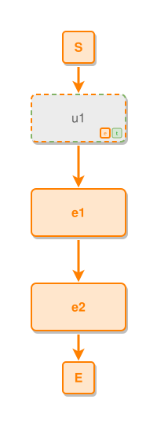

<!-- AUTO-GENERATED FILE - DO NOT EDIT -->
<!-- Generated by: gen-test-md -->
<!-- Command: go run ./cmd-dev/gen-test-md -->

# an-event-primary-undecided-node-joins-the-spine

> **⚠️ Warning:** This file is auto-generated. Manual changes will be lost when tests are regenerated.

**Source:** gl:docs/dev/layout-gen/layout-alg.md#L3085-L3087 | [docs/dev/layout-gen/layout-alg.md](../../docs/dev/layout-gen/layout-alg.md#an-event-primary-undecided-node-joins-the-spine)

## ipmt Content

```ipmt
e1 ::e --> e2 ::e
u1 ::?et --> e1
```

## Generated Files

- [an-event-primary-undecided-node-joins-the-spine.ipmt](an-event-primary-undecided-node-joins-the-spine.ipmt) - ipmt input
- [an-event-primary-undecided-node-joins-the-spine.json](an-event-primary-undecided-node-joins-the-spine.json) - Parsed structure
- [an-event-primary-undecided-node-joins-the-spine.layout.json](an-event-primary-undecided-node-joins-the-spine.layout.json) - Layout coordinates
- [an-event-primary-undecided-node-joins-the-spine.ipm.svg](an-event-primary-undecided-node-joins-the-spine.ipm.svg) - Rendered diagram

## Layout Validation Rules

Test line: 3085

✅ All 5 rules passed

- ✓ [Line 53](gl:docs/dev/layout-gen/layout-alg.md#L53): `each edge has max-bends=0` ([edges-run-straight-by-default.dsl](../layout-gen-rules/edges-run-straight-by-default.dsl))
- ✓ [Line 3096](gl:docs/dev/layout-gen/layout-alg.md#L3096): `#u1,#e1,#e2 have same center-x` ([an-event-primary-undecided-node-joins-the-spine.dsl](../layout-gen-rules/an-event-primary-undecided-node-joins-the-spine.dsl))
- ✓ [Line 3097](gl:docs/dev/layout-gen/layout-alg.md#L3097): `#e1 is below #u1 with gap=60` ([an-event-primary-undecided-node-joins-the-spine-02.dsl](../layout-gen-rules/an-event-primary-undecided-node-joins-the-spine-02.dsl))
- ✓ [Line 3098](gl:docs/dev/layout-gen/layout-alg.md#L3098): `edge #u1,#e1 has type=leadsto` ([an-event-primary-undecided-node-joins-the-spine-03.dsl](../layout-gen-rules/an-event-primary-undecided-node-joins-the-spine-03.dsl))
- ✓ [Line 3099](gl:docs/dev/layout-gen/layout-alg.md#L3099): `edge #u1,#e1 is vertical` ([an-event-primary-undecided-node-joins-the-spine-04.dsl](../layout-gen-rules/an-event-primary-undecided-node-joins-the-spine-04.dsl))

## Rendered Diagram



This test case was automatically generated from the specification document.

The ipmt code block was extracted using [sync-test-cases](../../docs/dev/testing.md) and saved to [an-event-primary-undecided-node-joins-the-spine.ipmt](an-event-primary-undecided-node-joins-the-spine.ipmt), then parsed into the [JSON structure](an-event-primary-undecided-node-joins-the-spine.json) and laid out into [layout coordinates](an-event-primary-undecided-node-joins-the-spine.layout.json). The [SVG diagram](an-event-primary-undecided-node-joins-the-spine.ipm.svg) was rendered using [ipmsvg-gen](../../docs/ipmsvg-gen.md).
