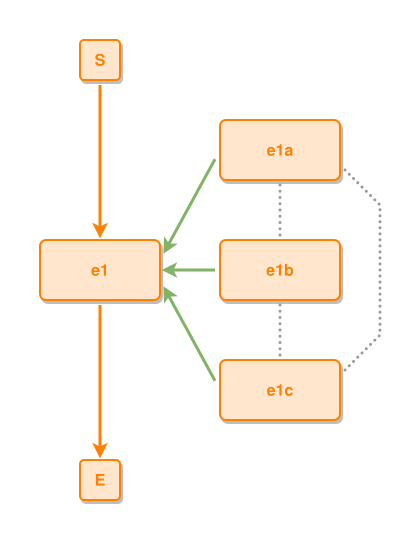

<!-- AUTO-GENERATED FILE - DO NOT EDIT -->
<!-- Generated by: gen-test-md -->
<!-- Command: go run ./cmd-dev/gen-test-md -->

# near-to-peers-in-a-column-neighbours-link-the-spanning-tie-bypasses

> **⚠️ Warning:** This file is auto-generated. Manual changes will be lost when tests are regenerated.

**Source:** gl:docs/dev/layout-gen/layout-alg.md#L3371-L3381 | [docs/dev/layout-gen/layout-alg.md](../../docs/dev/layout-gen/layout-alg.md#near-to-peers-in-a-column-neighbours-link-the-spanning-tie-bypasses)

## ipmt Content

```ipmt
e1a
e1b
e1c
e1
e1a --::P--> e1
e1b --::P--> e1
e1c --::P--> e1
e1a --- e1b
e1b --- e1c
e1a --- e1c
```

## Generated Files

- [near-to-peers-in-a-column-neighbours-link-the-spanning-tie-bypasses.ipmt](near-to-peers-in-a-column-neighbours-link-the-spanning-tie-bypasses.ipmt) - ipmt input
- [near-to-peers-in-a-column-neighbours-link-the-spanning-tie-bypasses.json](near-to-peers-in-a-column-neighbours-link-the-spanning-tie-bypasses.json) - Parsed structure
- [near-to-peers-in-a-column-neighbours-link-the-spanning-tie-bypasses.layout.json](near-to-peers-in-a-column-neighbours-link-the-spanning-tie-bypasses.layout.json) - Layout coordinates
- [near-to-peers-in-a-column-neighbours-link-the-spanning-tie-bypasses.ipm.svg](near-to-peers-in-a-column-neighbours-link-the-spanning-tie-bypasses.ipm.svg) - Rendered diagram

## Layout Validation Rules

Test line: 3371

⚠️ 17/18 rules passed

- ✗ [Line 53](gl:docs/dev/layout-gen/layout-alg.md#L53): `each edge has max-bends=0` - **edge e1a->e1c has 2 bends > max-bends 0 (each-edge default; if the detour is intended, add it to `except` and pin it with `edge #e1a,#e1c has max-bends=2`)** ([edges-run-straight-by-default.dsl](../layout-gen-rules/edges-run-straight-by-default.dsl))
- ✓ [Line 3418](gl:docs/dev/layout-gen/layout-alg.md#L3418): `#e1a,#e1b,#e1c have same center-x` ([near-to-peers-in-a-column-neighbours-link-the-spanning-tie-bypasses.dsl](../layout-gen-rules/near-to-peers-in-a-column-neighbours-link-the-spanning-tie-bypasses.dsl))
- ✓ [Line 3419](gl:docs/dev/layout-gen/layout-alg.md#L3419): `#e1 is left-of #e1a with gap=60` ([near-to-peers-in-a-column-neighbours-link-the-spanning-tie-bypasses-02.dsl](../layout-gen-rules/near-to-peers-in-a-column-neighbours-link-the-spanning-tie-bypasses-02.dsl))
- ✓ [Line 3420](gl:docs/dev/layout-gen/layout-alg.md#L3420): `edge #e1a,#e1b is vertical` ([near-to-peers-in-a-column-neighbours-link-the-spanning-tie-bypasses-03.dsl](../layout-gen-rules/near-to-peers-in-a-column-neighbours-link-the-spanning-tie-bypasses-03.dsl))
- ✓ [Line 3421](gl:docs/dev/layout-gen/layout-alg.md#L3421): `edge #e1a,#e1b has visibility=visible` ([near-to-peers-in-a-column-neighbours-link-the-spanning-tie-bypasses-04.dsl](../layout-gen-rules/near-to-peers-in-a-column-neighbours-link-the-spanning-tie-bypasses-04.dsl))
- ✓ [Line 3422](gl:docs/dev/layout-gen/layout-alg.md#L3422): `edge #e1a,#e1b has source-position=0.5` ([near-to-peers-in-a-column-neighbours-link-the-spanning-tie-bypasses-05.dsl](../layout-gen-rules/near-to-peers-in-a-column-neighbours-link-the-spanning-tie-bypasses-05.dsl))
- ✓ [Line 3423](gl:docs/dev/layout-gen/layout-alg.md#L3423): `edge #e1a,#e1b has target-position=0.5` ([near-to-peers-in-a-column-neighbours-link-the-spanning-tie-bypasses-06.dsl](../layout-gen-rules/near-to-peers-in-a-column-neighbours-link-the-spanning-tie-bypasses-06.dsl))
- ✓ [Line 3424](gl:docs/dev/layout-gen/layout-alg.md#L3424): `edge #e1b,#e1c is vertical` ([near-to-peers-in-a-column-neighbours-link-the-spanning-tie-bypasses-07.dsl](../layout-gen-rules/near-to-peers-in-a-column-neighbours-link-the-spanning-tie-bypasses-07.dsl))
- ✓ [Line 3425](gl:docs/dev/layout-gen/layout-alg.md#L3425): `edge #e1b,#e1c has visibility=visible` ([near-to-peers-in-a-column-neighbours-link-the-spanning-tie-bypasses-08.dsl](../layout-gen-rules/near-to-peers-in-a-column-neighbours-link-the-spanning-tie-bypasses-08.dsl))
- ✓ [Line 3426](gl:docs/dev/layout-gen/layout-alg.md#L3426): `edge #e1b,#e1c has source-position=0.5` ([near-to-peers-in-a-column-neighbours-link-the-spanning-tie-bypasses-09.dsl](../layout-gen-rules/near-to-peers-in-a-column-neighbours-link-the-spanning-tie-bypasses-09.dsl))
- ✓ [Line 3427](gl:docs/dev/layout-gen/layout-alg.md#L3427): `edge #e1b,#e1c has target-position=0.5` ([near-to-peers-in-a-column-neighbours-link-the-spanning-tie-bypasses-10.dsl](../layout-gen-rules/near-to-peers-in-a-column-neighbours-link-the-spanning-tie-bypasses-10.dsl))
- ✓ [Line 3428](gl:docs/dev/layout-gen/layout-alg.md#L3428): `each edge has max-bends=0 except #e1a,#e1c` ([near-to-peers-in-a-column-neighbours-link-the-spanning-tie-bypasses-11.dsl](../layout-gen-rules/near-to-peers-in-a-column-neighbours-link-the-spanning-tie-bypasses-11.dsl))
- ✓ [Line 3429](gl:docs/dev/layout-gen/layout-alg.md#L3429): `edge #e1a,#e1c has visibility=visible` ([near-to-peers-in-a-column-neighbours-link-the-spanning-tie-bypasses-12.dsl](../layout-gen-rules/near-to-peers-in-a-column-neighbours-link-the-spanning-tie-bypasses-12.dsl))
- ✓ [Line 3430](gl:docs/dev/layout-gen/layout-alg.md#L3430): `edge #e1a,#e1c has source-side=right` ([near-to-peers-in-a-column-neighbours-link-the-spanning-tie-bypasses-13.dsl](../layout-gen-rules/near-to-peers-in-a-column-neighbours-link-the-spanning-tie-bypasses-13.dsl))
- ✓ [Line 3431](gl:docs/dev/layout-gen/layout-alg.md#L3431): `edge #e1a,#e1c has source-position=0.75` ([near-to-peers-in-a-column-neighbours-link-the-spanning-tie-bypasses-14.dsl](../layout-gen-rules/near-to-peers-in-a-column-neighbours-link-the-spanning-tie-bypasses-14.dsl))
- ✓ [Line 3432](gl:docs/dev/layout-gen/layout-alg.md#L3432): `edge #e1a,#e1c has target-side=right` ([near-to-peers-in-a-column-neighbours-link-the-spanning-tie-bypasses-15.dsl](../layout-gen-rules/near-to-peers-in-a-column-neighbours-link-the-spanning-tie-bypasses-15.dsl))
- ✓ [Line 3433](gl:docs/dev/layout-gen/layout-alg.md#L3433): `edge #e1a,#e1c has target-position=0.25` ([near-to-peers-in-a-column-neighbours-link-the-spanning-tie-bypasses-16.dsl](../layout-gen-rules/near-to-peers-in-a-column-neighbours-link-the-spanning-tie-bypasses-16.dsl))
- ✓ [Line 3434](gl:docs/dev/layout-gen/layout-alg.md#L3434): `edge #e1a,#e1c has max-bends=2` ([near-to-peers-in-a-column-neighbours-link-the-spanning-tie-bypasses-17.dsl](../layout-gen-rules/near-to-peers-in-a-column-neighbours-link-the-spanning-tie-bypasses-17.dsl))

## Rendered Diagram



This test case was automatically generated from the specification document.

The ipmt code block was extracted using [sync-test-cases](../../docs/dev/testing.md) and saved to [near-to-peers-in-a-column-neighbours-link-the-spanning-tie-bypasses.ipmt](near-to-peers-in-a-column-neighbours-link-the-spanning-tie-bypasses.ipmt), then parsed into the [JSON structure](near-to-peers-in-a-column-neighbours-link-the-spanning-tie-bypasses.json) and laid out into [layout coordinates](near-to-peers-in-a-column-neighbours-link-the-spanning-tie-bypasses.layout.json). The [SVG diagram](near-to-peers-in-a-column-neighbours-link-the-spanning-tie-bypasses.ipm.svg) was rendered using [ipmsvg-gen](../../docs/ipmsvg-gen.md).
