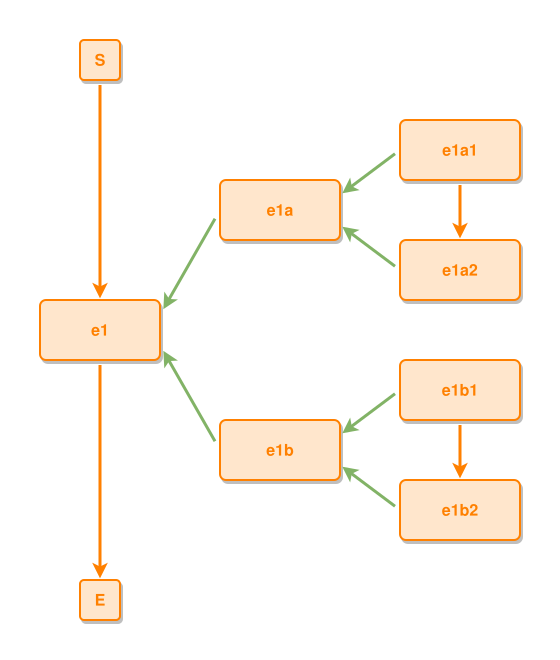

<!-- AUTO-GENERATED FILE - DO NOT EDIT -->
<!-- Generated by: gen-test-md -->
<!-- Command: go run ./cmd-dev/gen-test-md -->

# sibling-composites-keep-their-own-grids-apart

> **⚠️ Warning:** This file is auto-generated. Manual changes will be lost when tests are regenerated.

**Source:** gl:docs/dev/layout-gen/layout-alg.md#L975-L980 | [docs/dev/layout-gen/layout-alg.md](../../docs/dev/layout-gen/layout-alg.md#sibling-composites-keep-their-own-grids-apart)

## ipmt Content

```ipmt
e1a ::e, e1b ::e --::P--> e1 ::e
e1a1 ::e --> e1a2 ::e
e1a1, e1a2 --::P--> e1a
e1b1 ::e --> e1b2 ::e
e1b1, e1b2 --::P--> e1b
```

## Generated Files

- [sibling-composites-keep-their-own-grids-apart.ipmt](sibling-composites-keep-their-own-grids-apart.ipmt) - ipmt input
- [sibling-composites-keep-their-own-grids-apart.json](sibling-composites-keep-their-own-grids-apart.json) - Parsed structure
- [sibling-composites-keep-their-own-grids-apart.layout.json](sibling-composites-keep-their-own-grids-apart.layout.json) - Layout coordinates
- [sibling-composites-keep-their-own-grids-apart.ipm.svg](sibling-composites-keep-their-own-grids-apart.ipm.svg) - Rendered diagram

## Layout Validation Rules

Test line: 975

✅ All 14 rules passed

- ✓ [Line 53](gl:docs/dev/layout-gen/layout-alg.md#L53): `each edge has max-bends=0` ([edges-run-straight-by-default.dsl](../layout-gen-rules/edges-run-straight-by-default.dsl))
- ✓ [Line 82](gl:docs/dev/layout-gen/layout-alg.md#L82): `type=event has width=120` ([one-event.dsl](../layout-gen-rules/one-event.dsl))
- ✓ [Line 83](gl:docs/dev/layout-gen/layout-alg.md#L83): `type=event has min-gap-to-others>=10` ([one-event-02.dsl](../layout-gen-rules/one-event-02.dsl))
- ✓ [Line 84](gl:docs/dev/layout-gen/layout-alg.md#L84): `type=boundary has size=40x40` ([one-event-03.dsl](../layout-gen-rules/one-event-03.dsl))
- ✓ [Line 1000](gl:docs/dev/layout-gen/layout-alg.md#L1000): `#e1a,#e1b have same center-x` ([sibling-composites-keep-their-own-grids-apart.dsl](../layout-gen-rules/sibling-composites-keep-their-own-grids-apart.dsl))
- ✓ [Line 1001](gl:docs/dev/layout-gen/layout-alg.md#L1001): `#e1a1,#e1a2,#e1b1,#e1b2 have same center-x` ([sibling-composites-keep-their-own-grids-apart-02.dsl](../layout-gen-rules/sibling-composites-keep-their-own-grids-apart-02.dsl))
- ✓ [Line 1002](gl:docs/dev/layout-gen/layout-alg.md#L1002): `#e1a2 is below #e1a1 with gap=60` ([sibling-composites-keep-their-own-grids-apart-03.dsl](../layout-gen-rules/sibling-composites-keep-their-own-grids-apart-03.dsl))
- ✓ [Line 1003](gl:docs/dev/layout-gen/layout-alg.md#L1003): `#e1b1 is below #e1a2 with gap=60` ([sibling-composites-keep-their-own-grids-apart-04.dsl](../layout-gen-rules/sibling-composites-keep-their-own-grids-apart-04.dsl))
- ✓ [Line 1004](gl:docs/dev/layout-gen/layout-alg.md#L1004): `#e1b2 is below #e1b1 with gap=60` ([sibling-composites-keep-their-own-grids-apart-05.dsl](../layout-gen-rules/sibling-composites-keep-their-own-grids-apart-05.dsl))
- ✓ [Line 1005](gl:docs/dev/layout-gen/layout-alg.md#L1005): `#e1a1 is right-of #e1a with gap=60` ([sibling-composites-keep-their-own-grids-apart-06.dsl](../layout-gen-rules/sibling-composites-keep-their-own-grids-apart-06.dsl))
- ✓ [Line 1006](gl:docs/dev/layout-gen/layout-alg.md#L1006): `#e1a is vertically-centered-between #e1a1,#e1a2` ([sibling-composites-keep-their-own-grids-apart-07.dsl](../layout-gen-rules/sibling-composites-keep-their-own-grids-apart-07.dsl))
- ✓ [Line 1007](gl:docs/dev/layout-gen/layout-alg.md#L1007): `#e1b is vertically-centered-between #e1b1,#e1b2` ([sibling-composites-keep-their-own-grids-apart-08.dsl](../layout-gen-rules/sibling-composites-keep-their-own-grids-apart-08.dsl))
- ✓ [Line 1008](gl:docs/dev/layout-gen/layout-alg.md#L1008): `#e1 is vertically-centered-between #e1a,#e1b` ([sibling-composites-keep-their-own-grids-apart-09.dsl](../layout-gen-rules/sibling-composites-keep-their-own-grids-apart-09.dsl))
- ✓ [Line 1009](gl:docs/dev/layout-gen/layout-alg.md#L1009): `#S,#e1,#E have same center-x` ([sibling-composites-keep-their-own-grids-apart-10.dsl](../layout-gen-rules/sibling-composites-keep-their-own-grids-apart-10.dsl))

## Rendered Diagram



This test case was automatically generated from the specification document.

The ipmt code block was extracted using [sync-test-cases](../../docs/dev/testing.md) and saved to [sibling-composites-keep-their-own-grids-apart.ipmt](sibling-composites-keep-their-own-grids-apart.ipmt), then parsed into the [JSON structure](sibling-composites-keep-their-own-grids-apart.json) and laid out into [layout coordinates](sibling-composites-keep-their-own-grids-apart.layout.json). The [SVG diagram](sibling-composites-keep-their-own-grids-apart.ipm.svg) was rendered using [ipmsvg-gen](../../docs/ipmsvg-gen.md).
